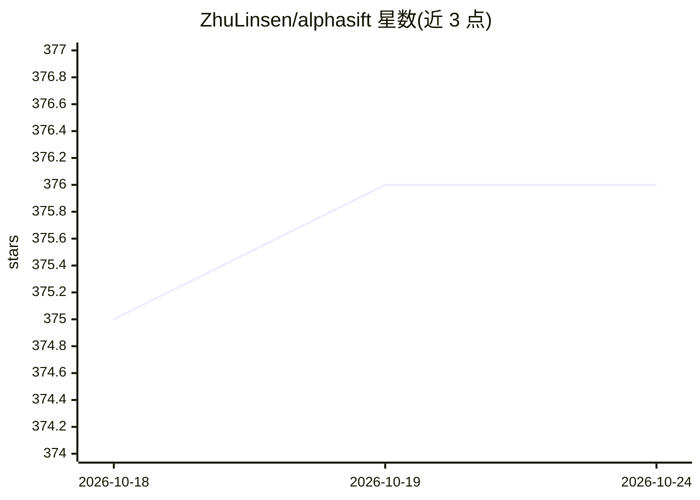

# ZhuLinsen/alphasift

⭐ 376 · Python · Apache-2.0 · 推送 2026-10-05 · [GitHub](https://github.com/ZhuLinsen/alphasift) · 个人维护 · 中文 README

**A股全市场选股筛选引擎：确定性因子+可选LLM排序与复盘评估**

面向量化研究者的股票发现与排序引擎：扫描全市场快照（示例5190只），经YAML策略硬过滤与因子打分（L1），可选叠加LLM跨候选推理排序（L2），再接入可插拔后分析（L3）。支持热点主题发现、日线特征增强（均线/MACD/RSI等），并保存运行记录供T+N回评：扣交易成本、标注跟进/假突破、计算回撤。通过SKILL.md向AI agent暴露接口；LLM可完全关闭（--no-llm）运行。声明仅供学习研究，非投资建议。数据源多级自动回退（sina/efinance/akshare_em/tushare等）。

## 筛选速览

| 维度 | 判定 | 备注 |
|---|---|---|
| AI 角色 | `ai-enhanced` | 去掉 AI 部分产品仍成立 |
| 许可风险 | `permissive` | Apache-2.0 |
| 部署形态 | `library` | 以包/库形式分发 |
| 模型依赖 | local-ok | 支持本地模型 |
| 硬件要求 | — | 无带数字的原话,不猜 |
| 安装摩擦 | `low` | 无编译、无系统依赖或容器化 |
| 成熟度 | — | 结构信号不足 |

## 能力要点

- 三层流水线：确定性硬过滤+因子打分 → 可选LLM排序 → 可插拔后分析
- T+N评估闭环：扣交易成本、标注跟进/假突破结果、复盘失败样本
- 10个内置YAML策略（价值/趋势/动量/质量等），支持自定义策略目录
- 通过SKILL.md提供agent可调用接口

## 适用场景

- 我想对全A股按价值或趋势因子做确定性初筛
- 我想让LLM对筛选候选做推理排序并给出论点与风险
- 我想在T+N后回评选股结果并复盘失败样本

## 场景标签

`金融量化` · 领域:学习与行业

## 证据(README 行号)

> L17: - **L2 optional LLM ranking**: structured cross-candidate reasoning, theses, catalysts, risks, confidence, and port
> L36: $ alphasift screen dual_low --no-llm

## 星数曲线

2026-10-18 375 → 2026-10-24 376（+1）

---
*卡片 v1 · prompt 1.4 · 生成 2026-10-22 · 置信度 high · 依据 README sha `e6d23324c715` · [字段定义](../../DATASET.md)*
