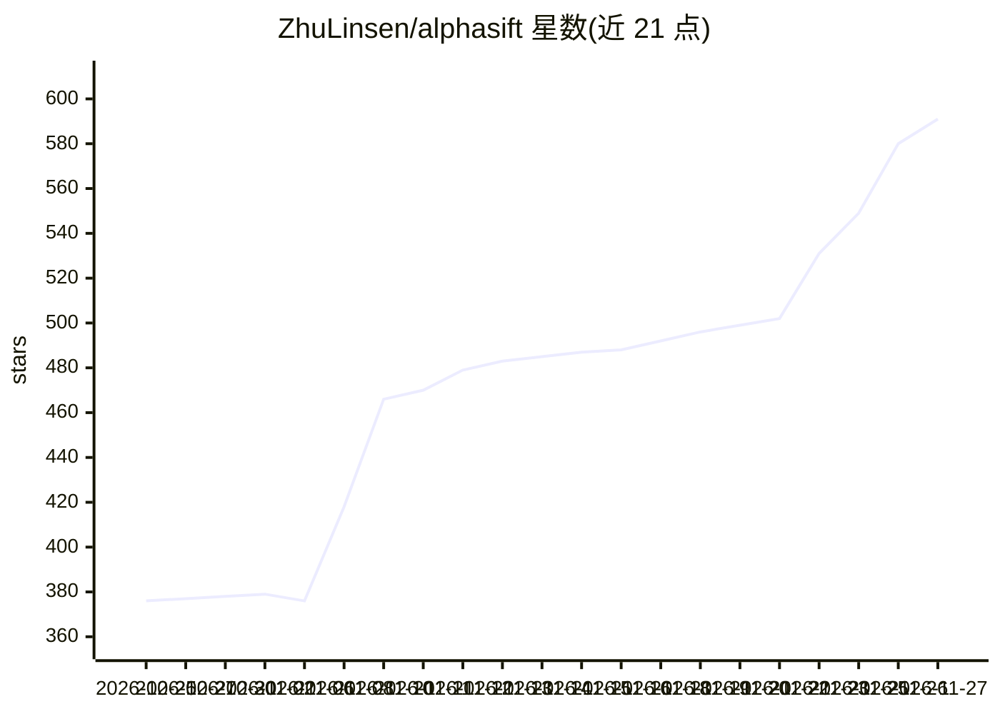

# ZhuLinsen/alphasift

⭐ 591 · Python · Apache-2.0 · 推送 2026-11-26 · [GitHub](https://github.com/ZhuLinsen/alphasift) · [官网](https://alphasift.zhulinsen.tech/) · 个人维护 · 中文 README

**覆盖 7 大市场的每日 AI 量化选股与公告排雷系统**

盘后从 A股、美股、港股、日韩台印 7 个市场 5,000+ 标的中按 12 套 YAML 量化策略做多因子初筛，接入大模型时注入公告、新闻与资金流上下文做情报复核与排雷，重大利空在代码层面硬性封顶分数；入选标的写入公开 track-record 账本，按 T+5/T+10/T+20 核算收益验证。无 API Key 可跑纯规则筛选；提供 PyPI 安装、MCP Server、本机 Web 工作台与 GitHub Actions 免费定时运行，支持 12 种推送渠道。README 声明不构成投资建议。

## 筛选速览

| 维度 | 判定 | 备注 |
|---|---|---|
| AI 角色 | `ai-native` | 本体是模型或模型工具 |
| 许可风险 | `permissive` | Apache-2.0 |
| 部署形态 | `self-host` | docker 或自建部署 |
| 模型依赖 | — | README 未给出锁定关系 |
| 硬件要求 | — | 无带数字的原话,不猜 |
| 安装摩擦 | `low` | 无编译、无系统依赖或容器化 |
| 成熟度 | — | 结构信号不足 |

## 能力要点

- 12 套公开 YAML 策略覆盖 7 大市场，含行业桶硬上限分散约束
- AI 情报复核：重大利空在 Python 代码层面硬封顶 ≤35 分
- 公开 track-record 账本按 next_open 口径核算 T+5/10/20 收益
- 内置零依赖 STDIO MCP Server（14 个只读工具）供 AI 助手调用

## 适用场景

- 每天盘后自动跑全市场选股并推送到飞书/企微/Telegram
- 用自然语言让 Claude Code 调用量化工具筛选股票
- 对照查看 AI 复核与纯规则策略的公开胜率记录
- 以 --no-llm 模式零成本做纯规则选股与回测

## 场景标签

`金融量化` · 领域:学习与行业

## 证据(README 行号)

> L55: 1. **全市场自动挑股（零 API Key 也能跑）**：覆盖 A股、美股、港股、日本、韩国、台湾、印度 7 大市场，内置 12 套公开可读的 YAML 量化策略与行业分散约束，每天几十秒跑完 `5,000+` 标的。
> L57: 3. **零成本定时运行 + 一句话接 AI 助手**：支持免费 GitHub Actions 每天盘后跑并推送到飞书/企微/Telegram/Discord/邮件等 12 个渠道（Fork 后默认只推送不发布重复网页）；内置零依
> L63: 安装 AlphaSift 后，在客户端 MCP 配置加入 5 行 JSON 即可让 AI 助手直接调用 `14` 个只读量化工具与 `4` 项资源（默认不触发外发推送）：

## 星数曲线

2026-10-25 376 → 2026-11-27 591（+215）

---
*卡片 v1 · prompt 1.4 · 生成 2026-11-26 · 置信度 high · 依据 README sha `17a5804725f1` · [字段定义](../../DATASET.md)*
