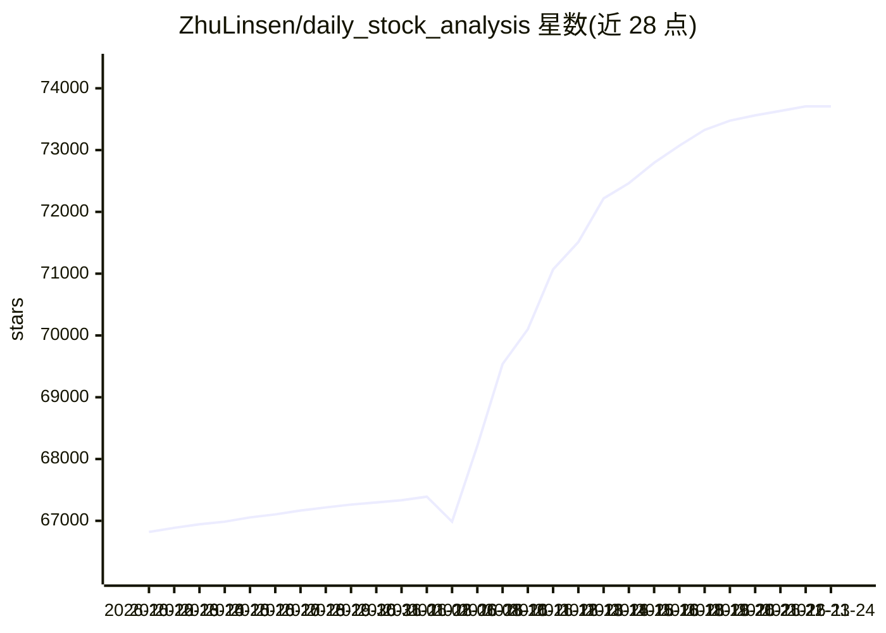

# ZhuLinsen/daily_stock_analysis

⭐ 74,008 · Python · MIT · 推送 2026-11-23 · [GitHub](https://github.com/ZhuLinsen/daily_stock_analysis) · [官网](https://dsa.zhulinsen.tech) · 个人维护 · 中文 README

**面向自选股投资者的多市场 LLM 每日分析推送系统**

基于 AI 大模型的 A股/港股/美股/日股/韩股/台股自选股分析系统：聚合行情、K 线、技术指标、新闻与公告数据，生成含结论、评分、买卖点位与风险警报的决策报告，并推送到企业微信/飞书/Telegram/Discord/Slack/邮箱。默认使用 AkShare、Baostock、YFinance 等免费行情源可零配置运行，可通过 GitHub Actions 在工作日定时执行而无需服务器；另提供 Web 工作台、Agent 策略问股，以及作为 Codex/Claude Code 插件的技能入口。README 声明仅供学习研究，不构成投资建议。

## 筛选速览

| 维度 | 判定 | 备注 |
|---|---|---|
| AI 角色 | `ai-native` | 本体是模型或模型工具 |
| 许可风险 | `permissive` | MIT |
| 部署形态 | `None` |  |
| 模型依赖 | local-ok | 支持本地模型 |
| 硬件要求 | — | 无带数字的原话,不猜 |
| 安装摩擦 | `low` | 无编译、无系统依赖或容器化 |
| 成熟度 | — | 结构信号不足 |

## 动量与使用信号

- 维护:`active` — 距上次 push 0.8 天,年发版 37,127 位贡献者
- 涨星:近 1 天 **+134**(自 20261016 起算)
- 平台:— · 协议:OLLAMA

## 能力要点

- 多市场行情聚合，默认内置免费数据源可零配置运行
- GitHub Actions 定时分析推送，无需服务器
- Agent 策略问股支持 15 种内置策略与多轮追问
- 提供 Codex / Claude Code 插件入口与只读 MCP 服务

## 适用场景

- 每个交易日自动分析自选股并推送决策仪表盘到工作群
- 在 Web 工作台用自然语言按缠论、均线等策略追问个股
- 用免费行情源零成本搭建个人股票分析定时任务

## 场景标签

`金融量化` · 领域:学习与行业

## 证据(README 行号)

> L18: > 🤖 基于 AI 大模型的 A股/港股/美股/日股/韩股/台股自选股智能分析系统，每日自动分析并推送「决策仪表盘」到企业微信/飞书/Telegram/Discord/Slack/邮箱
> L42: |AI 决策报告|核心结论、评分、趋势、买卖点位、风险警报、催化因素、操作检查清单|
> L55: |AI 模型|Modelflare、x6.ai、AIHubMix、Gemini、OpenAI 兼容、DeepSeek、通义千问、Claude、Ollama 本地模型等|

## 星数曲线

2026-10-22 66,820 → 2026-11-24 73,708（+6,888）

---
*卡片 v1 · prompt 1.4 · 生成 2026-11-24 · 置信度 high · 依据 README sha `205cfb7d612d` · [字段定义](../../DATASET.md)*
