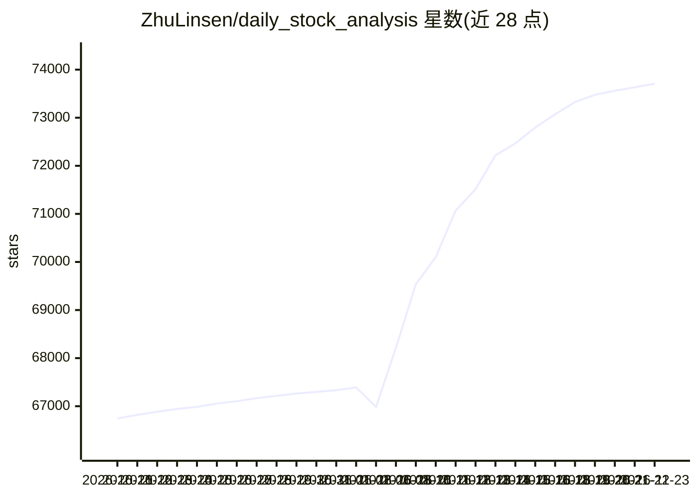

# ZhuLinsen/daily_stock_analysis

⭐ 73,708 · Python · MIT · 推送 2026-11-22 · [GitHub](https://github.com/ZhuLinsen/daily_stock_analysis) · [官网](https://dsa.zhulinsen.tech) · 个人维护 · 中文 README

**LLM 驱动的多市场自选股每日分析与推送系统**

面向 A股/港股/美股/日股/韩股/台股的自选股智能分析系统：聚合行情、K 线、技术指标、新闻与公告，调用大模型生成含结论、评分、买卖点位与风险警报的决策报告，并通过企业微信/飞书/Telegram/Discord/Slack/邮件推送。支持 GitHub Actions 零成本定时运行、本地/Docker 部署、Web 工作台、Agent 策略问股，以及作为 Codex/Claude Code 插件调用已部署实例。默认内置 AkShare 等免费行情源，稳定性受上游影响。

## 筛选速览

| 维度 | 判定 | 备注 |
|---|---|---|
| AI 角色 | `ai-native` | 本体是模型或模型工具 |
| 许可风险 | `permissive` | MIT |
| 部署形态 | `None` |  |
| 模型依赖 | local-ok | 支持本地模型 |
| 硬件要求 | — | 无带数字的原话,不猜 |
| 安装摩擦 | `low` | 无编译、无系统依赖或容器化 |
| 成熟度 | — | 结构信号不足 |

## 动量与使用信号

- 维护:`active` — 距上次 push 0.8 天,年发版 37,127 位贡献者
- 涨星:近 1 天 **+134**(自 20261016 起算)
- 平台:— · 协议:OLLAMA

## 能力要点

- 生成含核心结论、评分、买卖点位、风险警报的 AI 决策报告
- GitHub Actions 定时运行，无需服务器
- 15 种内置策略的多轮 Agent 问股，覆盖 Web/Bot/API
- 提供 agent-agnostic 插件入口（Codex/Claude Code marketplace）

## 适用场景

- 每个工作日自动分析自选股并推送到企业微信/飞书
- 在 Web 工作台手动分析个股并做多轮策略追问
- 以 Claude Code/Codex 插件形式调用已部署的分析服务

## 场景标签

`金融量化` · 领域:学习与行业

## 证据(README 行号)

> L18: > 🤖 基于 AI 大模型的 A股/港股/美股/日股/韩股/台股自选股智能分析系统，每日自动分析并推送「决策仪表盘」到企业微信/飞书/Telegram/Discord/Slack/邮箱
> L42: |AI 决策报告|核心结论、评分、趋势、买卖点位、风险警报、催化因素、操作检查清单|
> L45: |Agent 策略问股|多轮追问，支持均线、缠论、波浪、趋势、热点、事件、成长、预期等 15 种内置策略，覆盖 Web/Bot/API|

## 星数曲线

2026-10-21 66,745 → 2026-11-23 73,708（+6,963）

---
*卡片 v1 · prompt 1.4 · 生成 2026-11-22 · 置信度 high · 依据 README sha `371a2df2254d` · [字段定义](../../DATASET.md)*
