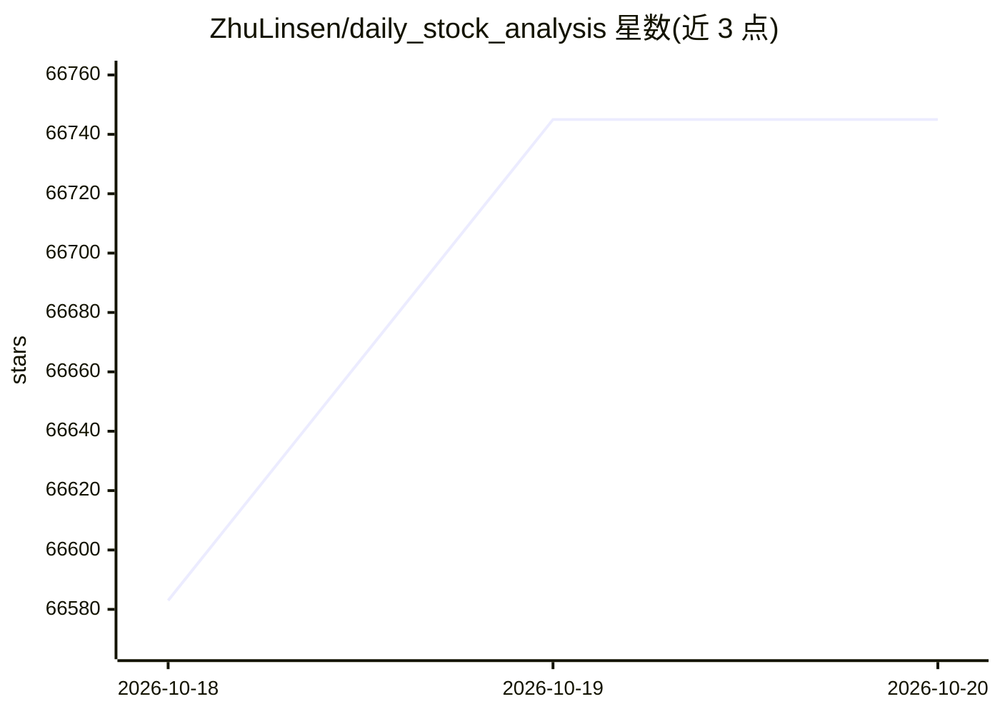

# ZhuLinsen/daily_stock_analysis

⭐ 66,745 · Python · MIT · 推送 2026-10-17 · [GitHub](https://github.com/ZhuLinsen/daily_stock_analysis) · [官网](https://dsa.zhulinsen.tech) · 个人维护 · 中文 README

**给个人投资者：LLM 每日自动分析自选股并推送决策仪表盘**

基于大模型的多市场股票分析系统，覆盖 A股/港股/美股/日股/韩股/台股与 ETF。聚合 AkShare、Tushare 等行情源与多路新闻搜索，生成包含结论、评分、买卖点位、风险警报的 AI 决策报告，并推送到企业微信/飞书/Telegram/Discord/Slack/邮箱。部署方式包括 GitHub Actions 定时运行（零成本、无需服务器）、本地运行与 Docker；附带 Web 工作台与 Agent 策略问股（15 种内置策略）。README 声明仅供学习研究，不构成投资建议。

## 筛选速览

| 维度 | 判定 | 备注 |
|---|---|---|
| AI 角色 | `ai-enhanced` | 去掉 AI 部分产品仍成立 |
| 许可风险 | `permissive` | MIT |
| 部署形态 | `None` |  |
| 模型依赖 | local-ok | 支持本地模型 |
| 硬件要求 | — | 无带数字的原话,不猜 |
| 安装摩擦 | `low` | 无编译、无系统依赖或容器化 |
| 成熟度 | — | 结构信号不足 |

## 动量与使用信号

- 维护:`active` — 距上次 push 0.8 天,年发版 37,127 位贡献者
- 涨星:近 1 天 **+134**(自 20261016 起算)
- 平台:— · 协议:OLLAMA

## 能力要点

- 每日自动分析并推送决策仪表盘到 6 类通知渠道
- GitHub Actions 定时运行，零成本无需服务器
- Agent 策略问股：多轮追问，15 种内置策略
- 多源行情（AkShare/Tushare/Baostock/YFinance 等）默认零配置可运行

## 适用场景

- 每个工作日自动收到自选股的 AI 分析报告推送
- 在 Web 工作台通过对话式 Agent 按策略问股
- 用免费数据源零成本搭建个人股票定时分析流水线

## 场景标签

`金融量化` · 领域:学习与行业

## 证据(README 行号)

> L13: > 🤖 基于 AI 大模型的 A股/港股/美股/日股/韩股/台股自选股智能分析系统，每日自动分析并推送「决策仪表盘」到企业微信/飞书/Telegram/Discord/Slack/邮箱
> L48: |AI 模型|Modelflare、AIHubMix、Gemini、OpenAI 兼容、DeepSeek、通义千问、Claude、Ollama 本地模型等|

## 星数曲线

2026-10-18 66,583 → 2026-10-20 66,745（+162）

---
*卡片 v1 · prompt 1.4 · 生成 2026-10-18 · 置信度 high · 依据 README sha `cb22c0f9e454` · [字段定义](../../DATASET.md)*
