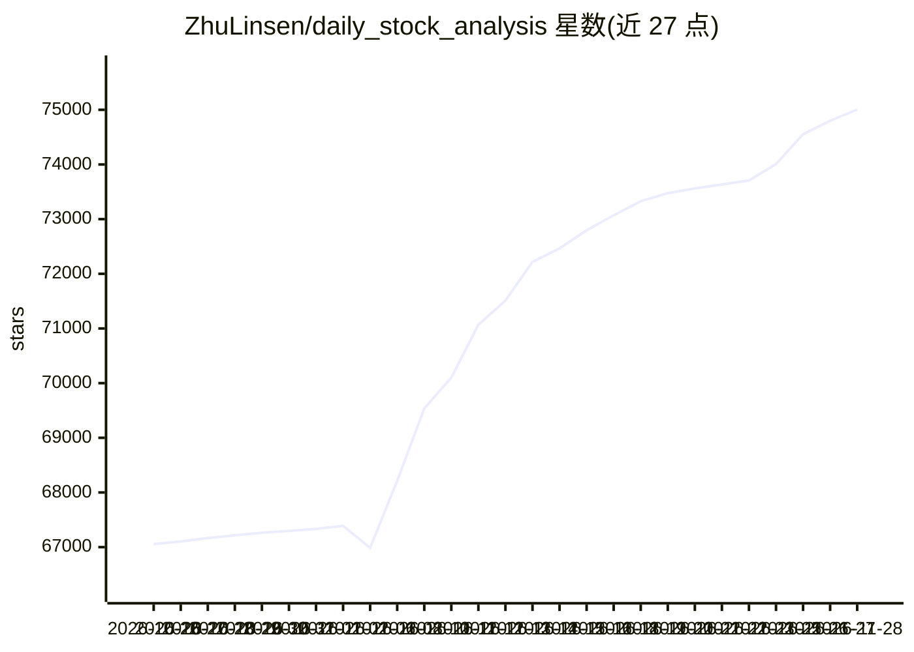

# ZhuLinsen/daily_stock_analysis

⭐ 75,005 · Python · MIT · 推送 2026-11-27 · [GitHub](https://github.com/ZhuLinsen/daily_stock_analysis) · [官网](https://dsa.zhulinsen.tech) · 个人维护 · 中文 README

**给个人投资者的 LLM 多市场股票每日分析推送系统**

基于 LLM 的 A股/港股/美股/日股/韩股/台股自选股分析系统：聚合行情、K 线、技术指标、新闻与公告数据，生成含结论、评分、买卖点位与风险提示的决策报告，并推送到企业微信/飞书/Telegram/Discord/Slack/邮箱。支持 GitHub Actions 零成本定时运行、Docker/本地部署、Web 工作台、多轮策略问股 Agent（20 种内置策略），并可作为 Codex/Claude Code 插件安装。默认使用免费行情源，仅供学习研究，不构成投资建议。

## 筛选速览

| 维度 | 判定 | 备注 |
|---|---|---|
| AI 角色 | `ai-native` | 本体是模型或模型工具 |
| 许可风险 | `permissive` | MIT |
| 部署形态 | `None` |  |
| 模型依赖 | local-ok | 支持本地模型 |
| 硬件要求 | — | 无带数字的原话,不猜 |
| 安装摩擦 | `low` | 无编译、无系统依赖或容器化 |
| 成熟度 | — | 结构信号不足 |

## 动量与使用信号

- 维护:`active` — 距上次 push 0.8 天,年发版 37,127 位贡献者
- 涨星:近 1 天 **+134**(自 20261016 起算)
- 平台:— · 协议:OLLAMA

## 能力要点

- 多市场行情/新闻聚合，LLM 生成含买卖点位与风险提示的决策报告
- GitHub Actions 每工作日 18:00 定时运行，零服务器成本
- Agent 策略问股：均线、缠论、波浪等 20 种内置策略，多轮追问
- 可作为 Codex / Claude Code 插件，提供只读 MCP 服务

## 适用场景

- 每日自动分析自选股并把决策仪表盘推送到企业微信/飞书
- 在 Web 工作台做多轮策略问股与历史报告查看
- 用 GitHub Actions 零成本跑定时行情分析

## 场景标签

`金融量化` · 领域:学习与行业

## 证据(README 行号)

> L18: > 🤖 基于 AI 大模型的 A股/港股/美股/日股/韩股/台股自选股智能分析系统，每日自动分析并推送「决策仪表盘」到企业微信/飞书/Telegram/Discord/Slack/邮箱
> L42: |AI 决策报告|核心结论、评分、趋势、买卖点位、风险警报、催化因素、操作检查清单|
> L55: |AI 模型|Modelflare、x6.ai、Gemini、OpenAI 兼容、DeepSeek、通义千问、Claude、Ollama 本地模型等|

## 星数曲线

2026-10-26 67,055 → 2026-11-28 75,005（+7,950）

---
*卡片 v1 · prompt 1.4 · 生成 2026-11-28 · 置信度 high · 依据 README sha `9fb9a293bdfc` · [字段定义](../../DATASET.md)*
