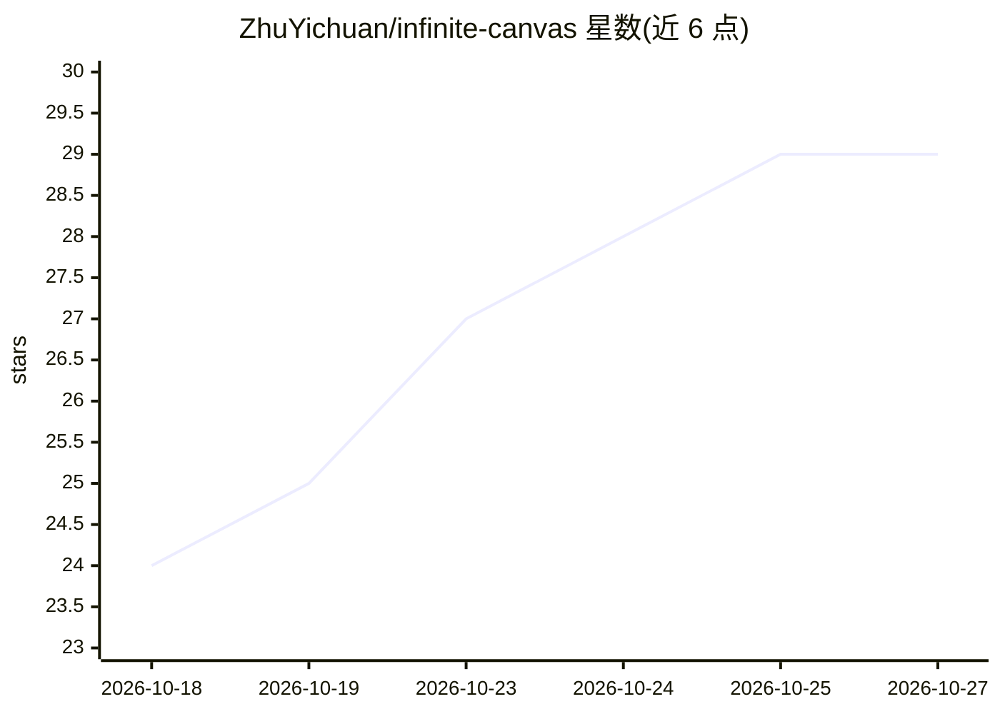

# ZhuYichuan/infinite-canvas

⭐ 29 · TypeScript · MIT · 推送 2026-10-25 · [GitHub](https://github.com/ZhuYichuan/infinite-canvas) · [官网](https://canvas.imihoo.com) · 个人维护 · 中文 README

**面向 ComfyUI 的无限画布 AI 创作工作台，纯前端直连生图/视频**

基于 basketikun/infinite-canvas fork 的纯前端可视化工作台，仅支持 ComfyUI 渠道，浏览器直连其 REST/WebSocket 端点（默认 127.0.0.1:8188）。画布节点参数由工作流槽位动态驱动，内置文生图、图生图、局部重绘、参考视频、首尾帧等工作流；另含画布助手、通过 MCP 操作画布的 Canvas Agent（连接 Codex / Claude Code）、插件系统与提示词库。可本地 bun 开发、Docker 运行，或使用 LightCC / AutoDL 云端预装镜像免本地配置。

## 筛选速览

| 维度 | 判定 | 备注 |
|---|---|---|
| AI 角色 | `ai-native` | 本体是模型或模型工具 |
| 许可风险 | `permissive` | MIT |
| 部署形态 | `self-host` | docker 或自建部署 |
| 模型依赖 | — | README 未给出锁定关系 |
| 硬件要求 | — | 无带数字的原话,不猜 |
| 安装摩擦 | `low` | 无编译、无系统依赖或容器化 |
| 成熟度 | — | 结构信号不足 |

## 能力要点

- 纯前端架构，数据与凭据存浏览器本地，无服务端依赖
- 工作流槽位（_meta.title）动态驱动画布节点参数控件
- Canvas Agent 通过 MCP 连接 Codex / Claude Code 操作画布
- 支持 LightCC / AutoDL 云端预装镜像一键开机接入

## 适用场景

- 在无限画布上连续迭代 AI 生图与视频创作方案
- 无本地显卡时用云端镜像直接跑 ComfyUI 生成
- 通过 Agent 对话方式操作与生成画布内容

## 场景标签

`图像生成` `视频生成` · 领域:内容生成

## 证据(README 行号)

> L31: - **仅支持 ComfyUI**：生成渠道已全面收敛为本地自建 ComfyUI（默认 `http://127.0.0.1:8188`），浏览器前端直连 ComfyUI 官方 REST / WebSocket 端点，已移除 Ope
> L40: - ComfyUI 生成：文生图（T2I）、图生图（I2I）、局部重绘、全能参考视频、首尾帧视频等，能力由工作流槽位决定。

## 星数曲线

2026-10-18 24 → 2026-10-27 29（+5）

---
*卡片 v1 · prompt 1.4 · 生成 2026-10-26 · 置信度 high · 依据 README sha `4d7a0e5ae25d` · [字段定义](../../DATASET.md)*
