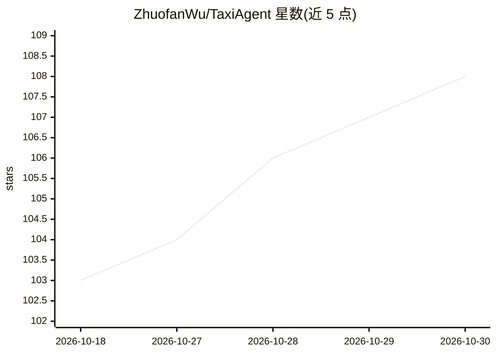

# ZhuofanWu/TaxiAgent

⭐ 108 · Java · MIT · 推送 2026-09-13 · [GitHub](https://github.com/ZhuofanWu/TaxiAgent) · 个人维护 · 中文 README

**网约车业务全栈实战项目：Redis 高并发 + 多 Agent + RAG**

Spring Boot 3 全栈实战项目，同一套网约车业务代码承载两条学习主线：Redis 高并发（Lua 抢单、GEO 派单、ZSet 延迟队列、缓存一致性三解法、分布式锁，配 25 篇代码级文档）与多 Agent 编排（前置意图分类路由、4 个领域 Agent 工具循环、订单 HITL 确认断点、Heap/Redis/MySQL 三层记忆、向量+BM25+RRF 混合检索 RAG）。路由用 Qwen 系列、执行用 DeepSeek，需自备 MySQL/Redis/MongoDB/Elasticsearch 与多个 API Key，通过 Maven 编译运行。

## 筛选速览

| 维度 | 判定 | 备注 |
|---|---|---|
| AI 角色 | `ai-native` | 本体是模型或模型工具 |
| 许可风险 | `permissive` | MIT |
| 部署形态 | `None` |  |
| 模型依赖 | locked-api |  |
| 硬件要求 | — | 无带数字的原话,不猜 |
| 安装摩擦 | `medium` | 含编译或系统依赖之一 |
| 成熟度 | — | 结构信号不足 |

## 能力要点

- 抢单 Lua 原子预检、GEO 附近派单、ZSet 延迟队列等 12 项 Redis 考点落在真实业务上
- 前置分类路由 + OrderAgent/DailyAgent/SupportAgent/FallbackAgent 四领域分工
- 订单创建前强制 HITL 确认断点，confirm/resume 事件可恢复
- 向量检索 + BM25 + RRF 融合的混合检索 RAG

## 适用场景

- 我想补 Redis 高并发的实战经验，看真实业务里的缓存一致性方案
- 学习如何把多 Agent 编排接入真实业务系统
- 参考订单确认断点（HITL）与多层记忆的工程实现
- 了解混合检索 RAG 在客服场景的落地方式

## 场景标签

`多智能体` `RAG` `Agent 记忆` · 领域:Agent 开发

## 证据(README 行号)

> L17: `TaxiAgent` 是一个网约车业务系统 + 一个多 Agent 应用。同一套代码上有**两条相互独立的学习主线**：
> L26: 回到 Agent 这条线，`TaxiAgent` 不是“一个大 Prompt + 一个大模型”式的 Demo，而是把网约车场景拆成了清晰的执行链路：
> L51: - **多 Agent 分工明确**：`OrderAgent`、`DailyAgent`、`SupportAgent`、`FallbackAgent`

## 星数曲线

2026-10-18 103 → 2026-10-30 108（+5）

---
*卡片 v1 · prompt 1.4 · 生成 2026-10-23 · 置信度 high · 依据 README sha `e51a2473867e` · [字段定义](../../DATASET.md)*
