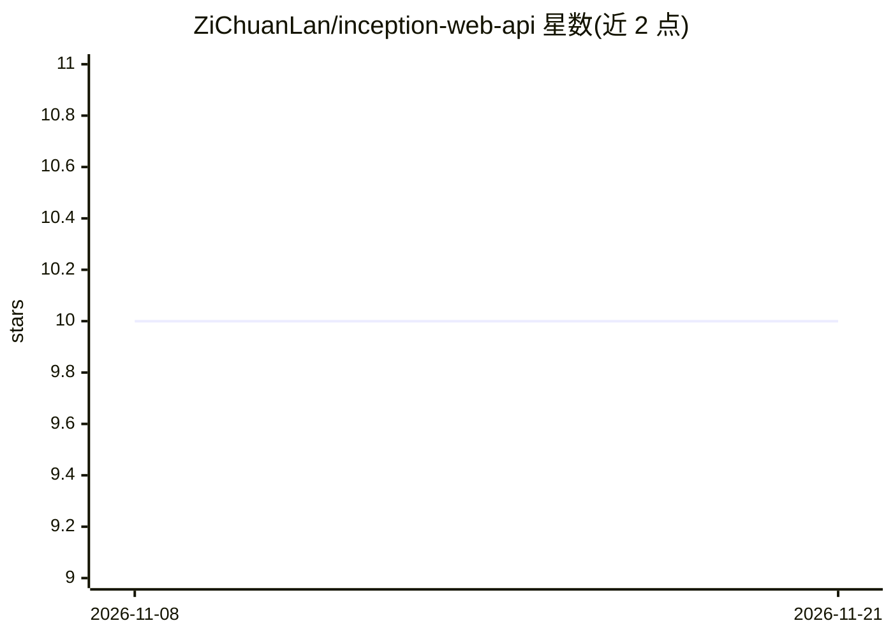

# ZiChuanLan/inception-web-api

⭐ 10 · Python · AGPL-3.0 · 推送 2026-11-04 · [GitHub](https://github.com/ZiChuanLan/inception-web-api) · 个人维护 · 中文 README

**Mercury 3 扩散模型的 OpenAI 兼容反向代理网关**

基于 chat.inceptionlabs.ai Web 协议实现的反向代理服务，将 Inception Labs Mercury 3 封装为 OpenAI 兼容 API。提供双引擎：Playwright 无头 Chromium 桥接（自动通过 Vercel 检查点与 Cloudflare Turnstile）与 curl_cffi 纯协议模式（无浏览器依赖）。支持 4 档思考深度、联网搜索、流式与非流式返回、Token 会话轮询池、tool calling 转译，可对接 OneAPI、Dify、OpenAI SDK 等客户端。部署方式包括 Docker 双镜像、裸机 Python 与 systemd 守护。README 声明仅供学习研究，AGPL-3.0 授权。

## 筛选速览

| 维度 | 判定 | 备注 |
|---|---|---|
| AI 角色 | `ai-ecosystem` | LLM/agent 周边工具 |
| 许可风险 | `viral` | AGPL-3.0 |
| 部署形态 | `self-host` | docker 或自建部署 |
| 模型依赖 | — | README 未给出锁定关系 |
| 硬件要求 | — | 无带数字的原话,不猜 |
| 安装摩擦 | `low` | 无编译、无系统依赖或容器化 |
| 成熟度 | — | 结构信号不足 |

## 能力要点

- 双引擎架构：browser 桥接（~650MB 镜像）与 curl 纯协议模式（~50MB，内存 25MB）
- OpenAI 兼容：SSE 流式、reasoning_effort 四档、tools/functions 转译
- 内置多会话 Token 轮询池（POOL_SIZE 默认 5）与上游重试/超时控制
- 联网搜索并返回 citations 来源引用

## 适用场景

- 让仅支持 OpenAI 格式的客户端接入 Mercury 3 模型
- 在机房 IP 的 VPS 上通过浏览器桥接自动通过防护检查
- 为 Agent 框架提供工具调用的协议转译

## 场景标签

`模型网关` · 领域:Agent 开发

## 证据(README 行号)

> L8: An OpenAI-compatible **API Gateway** for Inception Labs Mercury 3 (Diffusion LLM).
> L10: 基于 `chat.inceptionlabs.ai` Web 协议实现的 **OpenAI 兼容反向代理服务**。支持 Docker 双引擎架构一键切换、4 档思考深度与实时联网搜索。
> L40: - **🛠️ 工具调用与函数执行支持 (Tool / Function Calling Emulation)**：内置网关层双向协议虚拟化转译，完整兼容 OpenAI `tools`、`functions`、`tool_choic

## 星数曲线

2026-11-08 10 → 2026-11-21 10（+0）

---
*卡片 v1 · prompt 1.4 · 生成 2026-11-20 · 置信度 mid · 依据 README sha `420bf77a3466` · [字段定义](../../DATASET.md)*
