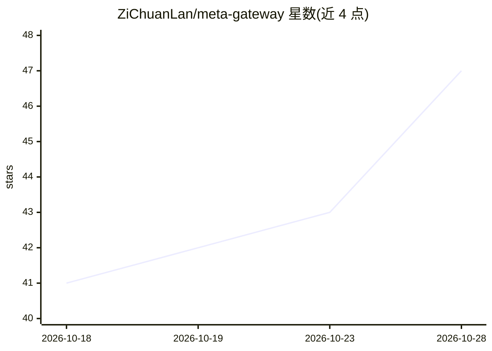

# ZiChuanLan/meta-gateway

⭐ 47 · Go · MIT · 推送 2026-10-27 · [GitHub](https://github.com/ZiChuanLan/meta-gateway) · [官网](https://mg.015201314.xyz) · 个人维护 · 中文 README

**自托管多通道 LLM 中继网关：统一上游、单令牌透传**

用 Go 编写的自托管 AI 网关，将分散的多个上游站点（New API、One API、官方接口等）统一挂载，下游客户端（Cursor、Claude Code、Open WebUI 等）只需配置一个接口地址与一个访问令牌即可访问全部模型。机制上坚持透明 pass-through（不改写请求语义、不注入提示词），支持 OpenAI/Anthropic/Gemini 协议双向互译、失败自动冷却与备用通道转移、跨渠道模型别名归一、渠道级端点覆盖、上游凭据 AES-GCM 加密存储。提供 Web 管理控制台（经典/现代双界面包）、令牌与额度管理、定时签到引擎、站点探针与 WebDAV 备份。以 Docker 部署为主，也支持源码构建。

## 筛选速览

| 维度 | 判定 | 备注 |
|---|---|---|
| AI 角色 | `ai-ecosystem` | LLM/agent 周边工具 |
| 许可风险 | `permissive` | MIT |
| 部署形态 | `self-host` | docker 或自建部署 |
| 模型依赖 | locked-api |  |
| 硬件要求 | — | 无带数字的原话,不猜 |
| 安装摩擦 | `low` | 无编译、无系统依赖或容器化 |
| 成熟度 | — | 结构信号不足 |

## 能力要点

- OpenAI / Anthropic / Gemini 原生格式自动双向互译
- 失败自动冷却并秒级转移到备用通道，恢复后无感回归
- 上游 API Key 以 MASTER_KEY AES-GCM 加密入库，出站前内存瞬时解密
- 经典 / 现代双控制台界面包，含令牌额度与模型路由分组管理

## 适用场景

- 把多个 LLM 上游站点聚合成一个接口地址给下游工具使用
- 渠道故障时自动切换备用通道，避免业务中断
- 为不同客户端分配专属的模型路由分组与额度

## 场景标签

`模型网关` · 领域:Agent 开发

## 证据(README 行号)

> L32: **Meta Gateway** 是自托管的多通道聚合中枢：所有上游统一挂载，下游只需配置**一个接口地址、一个访问令牌**。
> L41: |**协议不兼容**|OpenAI / Anthropic / Gemini 原生格式自动双向互译|
> L151: Nginx 是纯传输层转发，无法理解 AI 模型的语义。Meta Gateway 运行在应用协议层：它能够**解析 OpenAI / Claude / Gemini 的请求与流式包**，完成多协议互译、识别每个 Token 的用

## 星数曲线

2026-10-18 41 → 2026-10-28 47（+6）

---
*卡片 v1 · prompt 1.4 · 生成 2026-10-25 · 置信度 high · 依据 README sha `c384f564140a` · [字段定义](../../DATASET.md)*
