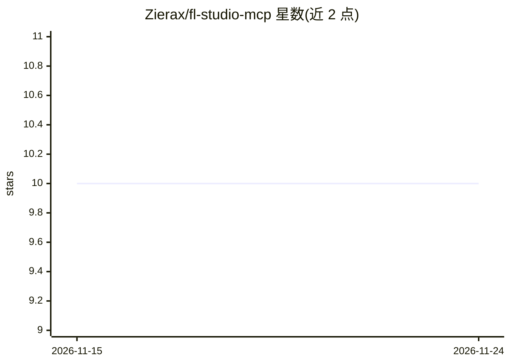

# Zierax/fl-studio-mcp

⭐ — · [GitHub]() · 个人维护

**让 AI 助手通过 MCP 完全控制 FL Studio 音乐制作**

一个 MCP 服务器，通过虚拟 MIDI 触发器加 JSON 命令通道，让 Claude、Cursor 等 MCP 客户端控制 FL Studio：传输控制、混音器、通道机架、插件参数、Pattern、步进音序器、钢琴卷帘及完整 FL 脚本 API。面向使用 AI 辅助音乐制作的 FL Studio 用户。要求 FL Studio 20.7+（Windows/macOS）、Python 3.10+、uv 及虚拟 MIDI 端口（loopMIDI 或 IAC Driver）。限制：API 无法创建通道或加载音频文件，Playlist 剪辑不能程序化摆放。附 nine-phase 制作工作流的 prompt 包。

## 筛选速览

| 维度 | 判定 | 备注 |
|---|---|---|
| AI 角色 | `ai-ecosystem` | LLM/agent 周边工具 |
| 许可风险 | `permissive` | — |
| 部署形态 | `None` |  |
| 模型依赖 | — | README 未给出锁定关系 |
| 硬件要求 | — | 无带数字的原话,不猜 |
| 安装摩擦 | `low` | 无编译、无系统依赖或容器化 |
| 成熟度 | — | 结构信号不足 |

## 能力要点

- 覆盖 transport/mixer/channel rack/patterns/钢琴卷帘等区域的 MCP 工具集
- 虚拟 MIDI 触发 + JSON 命令通道桥接 Python 与 FL 脚本 API
- 提供含九阶段制作工作流、12 种风格规格的 prompt 包
- fl_diagnostics 工具用于检查 MIDI 端口与配置问题

## 适用场景

- 用自然语言指挥 AI 设置 BPM、创建 pattern、编排鼓点
- 通过对话调整混音器音量、声像与 solo
- 在 FL Studio 中用 AI 辅助编写旋律与和弦

## 场景标签

 · 领域:音乐制作/AI 工具集成

## 证据(README 行号)

> L3: An MCP server that lets AI assistants
> L6: over a virtual MIDI trigger + JSON command channel.
> L18: MCP client (Claude, Cursor, ...)

## 星数曲线

2026-11-15 10 → 2026-11-24 10（+0）

---
*卡片 v1 · prompt 1.4 · 生成 2026-11-20 · 置信度 high · 依据 README sha `edfef088ace6` · [字段定义](../../DATASET.md)*
