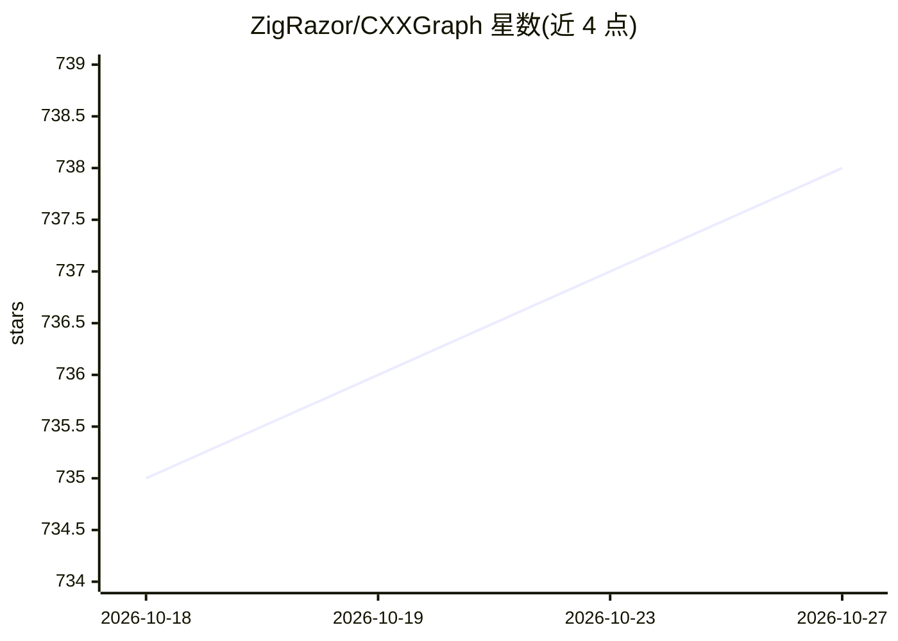

# ZigRazor/CXXGraph

⭐ 738 · C++ · MPL-2.0 · 推送 2026-09-10 · [GitHub](https://github.com/ZigRazor/CXXGraph) · [官网](https://zigrazor.github.io/CXXGraph/) · 个人维护

**给 C++ 开发者的头文件图算法库：图表示与常用算法**

CXXGraph 是一个 header-only 的 C++17 图算法库，提供节点/边图对象及大量算法：遍历（BFS/DFS/Bron–Kerbosch）、最短路径（Dijkstra/Bellman-Ford/Floyd–Warshall/Dial）、最小生成树（Prim/Kruskal/Borůvka）、网络流、连通性与环检测、拓扑排序、欧拉路径、图着色与顶点切分等，并含邻接矩阵/度矩阵/Laplacian 等网络动力学矩阵。README 自称可作为 Boost Graph Library 的替代。提供 tarball/RPM/DEB/CMake 源码安装与打包脚本。注意：本库本身不涉及 AI。

## 筛选速览

| 维度 | 判定 | 备注 |
|---|---|---|
| AI 角色 | `ai-ecosystem` | LLM/agent 周边工具 |
| 许可风险 | `permissive` | MPL-2.0 |
| 部署形态 | `None` |  |
| 模型依赖 | — | README 未给出锁定关系 |
| 硬件要求 | — | 无带数字的原话,不猜 |
| 安装摩擦 | `medium` | 含编译或系统依赖之一 |
| 成熟度 | — | 结构信号不足 |

## 能力要点

- header-only，仅需包含 CXXGraph.hpp 即可使用
- 覆盖遍历/最短路径/最小生成树/网络流/连通性/拓扑排序/着色/图分割等算法类别
- 提供 tarball、RPM、DEB 与 CMake 源码多种安装方式
- 支持网络动力学矩阵（邻接/度/Laplacian/转移矩阵）

## 适用场景

- 在 C++ 项目中直接引入图算法而无需 Boost 依赖
- 做最短路径、连通性、环检测等图分析计算
- 构建依赖排序或任务调度等拓扑排序场景

## 场景标签

 · 领域:软件开发/算法库

## 证据(README 行号)

> L18: **CXXGraph** is a comprehensive C++ library that manages graph algorithms. This header-only library serves as an al
> L78: - The minimum C++ standard required is **C++17**
> L83: To use the library, simply include the `CXXGraph/CXXGraph.hpp` file at the top of your file.

## 星数曲线

2026-10-18 735 → 2026-10-27 738（+3）

---
*卡片 v1 · prompt 1.4 · 生成 2026-10-21 · 置信度 low · 依据 README sha `82e5b160663a` · [字段定义](../../DATASET.md)*
