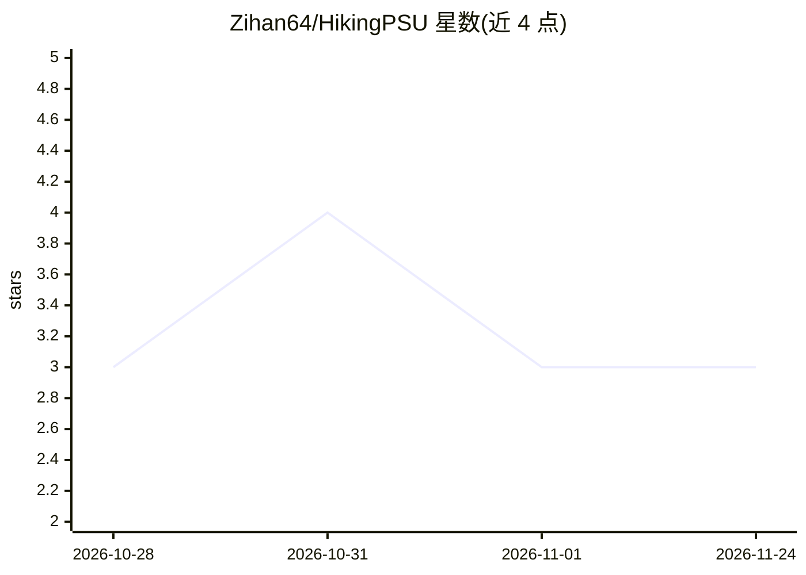

# Zihan64/HikingPSU

⭐ 3 · Python · 推送 2026-10-28 · [GitHub](https://github.com/Zihan64/HikingPSU) · [官网](https://hikingpsu.com/) · 个人维护

**宾州州立大学城地区的 AI 徒步路线规划向导**

面向 Penn State 与 State College 地区的 AI 徒步指南网站：用户用自然语言描述人数、时间、交通与偏好，agent 将其转为结构化搜索并推荐数据库中的真实步道。维护 52 条步道目录（12 条人工整理、40 条来自 OpenStreetMap），提供五级可解释难度评级（含评级理由）、无车可达性标注、天气预报与狩猎季提醒、地图视图、社区评论与打卡徽章。AI 仅能推荐数据库返回的步道，其余结果被移除。定位为区域试点，不做全球路线搜索。

## 筛选速览

| 维度 | 判定 | 备注 |
|---|---|---|
| AI 角色 | `ai-native` | 本体是模型或模型工具 |
| 许可风险 | `none` | — |
| 部署形态 | `desktop` | 安装包/桌面程序 |
| 模型依赖 | — | README 未给出锁定关系 |
| 硬件要求 | — | 无带数字的原话,不猜 |
| 安装摩擦 | `low` | 无编译、无系统依赖或容器化 |
| 成熟度 | — | 结构信号不足 |

## 能力要点

- 自然语言描述转为结构化步道搜索
- 五级难度评级且每级附带评级理由
- 无车优先：按公交/步行/骑行/驾车可达性过滤
- AI 只能推荐数据库返回的步道，防止编造

## 适用场景

- 没有汽车时寻找可乘公交或步行到达的步道
- 请 AI 按人数、时长和偏好推荐周边路线
- 查看步道难度评级理由与官方地图资源

## 场景标签

`聊天机器人` · 领域:对话与助手

## 证据(README 行号)

> L3: **An AI hiking guide for Penn State and State College, built around difficulty ratings you can trust.**
> L25: - **🗣️ Plan in plain English.** Describe your group, time, transport and mood. The agent turns that into a structur
> L36: - **🛡️ No made-up trails.** The AI can recommend only trails that come back from the database search. Anything else

## 星数曲线

2026-10-28 3 → 2026-11-24 3（+0）

---
*卡片 v1 · prompt 1.4 · 生成 2026-11-22 · 置信度 low · 依据 README sha `8683357fe4a2` · [字段定义](../../DATASET.md)*
