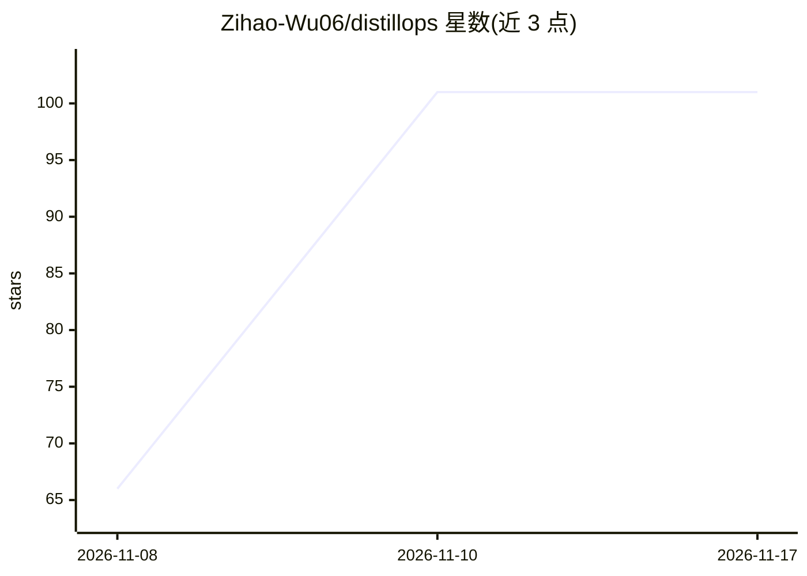

# Zihao-Wu06/distillops

⭐ 101 · Python · MIT · 推送 2026-11-04 · [GitHub](https://github.com/Zihao-Wu06/distillops) · 个人维护

**黑盒 LLM 蒸馏框架：教师答案经验证后训练小模型**

面向可验证任务的黑盒蒸馏工具链：用 Task 类定义数据、提示词、验证器与评分，调用任意 OpenAI 兼容端点（托管 API 或 vLLM/SGLang 自托管模型）作为教师，通过拒绝采样生成验证过的训练数据，再对 Hugging Face 上的任意因果 LM 学生模型执行 SFT、评测与 GRPO 强化学习，全程只需教师文本输出，不需权重或 logits。提供数学（GSM8K）、PII 检测、推荐三个内置示例，支持文本与图像输入，训练可在 24 GB GPU 上运行。

## 筛选速览

| 维度 | 判定 | 备注 |
|---|---|---|
| AI 角色 | `ai-ecosystem` | LLM/agent 周边工具 |
| 许可风险 | `permissive` | MIT |
| 部署形态 | `library` | 以包/库形式分发 |
| 模型依赖 | local-ok | 支持本地模型 |
| 硬件要求 | — | 无带数字的原话,不猜 |
| 安装摩擦 | `medium` | 含编译或系统依赖之一 |
| 成熟度 | — | 结构信号不足 |

## 能力要点

- Task 类一个抽象覆盖教师调用、拒绝采样、SFT、评测与 GRPO 全流程
- 兼容任意 OpenAI 兼容端点作为教师（托管 API 或 vLLM/SGLang 本地服务）
- 任意 Hugging Face 因果 LM 可作学生（Qwen/Llama/Mistral/Gemma 等）
- 无教师对照组与 95% 置信区间度量蒸馏增益

## 适用场景

- 把大模型擅长的抽取/分类/数学等任务蒸馏成本地小模型自持部署
- 在 24 GB 单卡上以低成本 API 调用复现并扩展 GSM8K 蒸馏路线
- 为自己的可验证任务编写 Task 类后执行完整蒸馏与 GRPO 训练

## 场景标签

`微调` `强化学习` · 领域:训练与推理

## 证据(README 行号)

> L24: your own machine. The large model, the *teacher*, answers your inputs. Your code checks every answer,
> L44: commands then collect verified teacher answers, fine-tune, evaluate and run GRPO, for any causal LM
> L100: - **Any verifiable task, one class.** Teacher calls, rejection sampling, SFT, evaluation and GRPO are

## 星数曲线

2026-11-08 66 → 2026-11-17 101（+35）

---
*卡片 v1 · prompt 1.4 · 生成 2026-11-17 · 置信度 high · 依据 README sha `3e1f41823048` · [字段定义](../../DATASET.md)*
