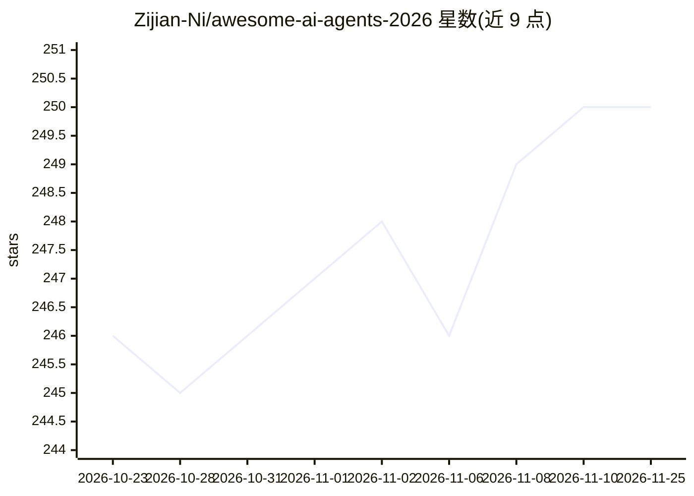

# Zijian-Ni/awesome-ai-agents-2026

⭐ 250 · Python · MIT · 推送 2026-11-23 · [GitHub](https://github.com/Zijian-Ni/awesome-ai-agents-2026) · 个人维护 · 中文 README

**面向构建 AI Agent 开发者的 2026 年资源策展清单**

按类别组织 AI 模型、Agent 框架、协议、工具与学习资源的策展清单，覆盖 26 个类别（基础模型、多模态、MCP/A2A 协议、框架、编码 Agent、安全、RAG、中文生态等），累计收录 800+ 条目。为每个条目提供状态标签体系（New/Stale/Archived/Unverified/Hot/China-first 等），并附场景指南、技术栈配方、反选清单与对比表，帮助读者按场景选型。条目含发布时间、定价与 API 可用性等事实信息。

## 筛选速览

| 维度 | 判定 | 备注 |
|---|---|---|
| AI 角色 | `ai-knowledge` | 知识聚合/清单类 |
| 许可风险 | `permissive` | MIT |
| 部署形态 | `None` |  |
| 模型依赖 | — | README 未给出锁定关系 |
| 硬件要求 | — | 无带数字的原话,不猜 |
| 安装摩擦 | `low` | 无编译、无系统依赖或容器化 |
| 成熟度 | — | 结构信号不足 |

## 能力要点

- 26 个类别组织的 Agent 生态条目（含 265+ 基础模型、60+ 框架）
- 条目状态标签体系：New/Stale/Hot/Unverified/China-first 等 11 种
- 场景指南（58 个场景映射）、Stack Recipes 与 Anti-Picks 反选清单
- 含中文 AI 生态专节，支持中/日双语

## 适用场景

- 按场景查找合适的 Agent 框架或工具
- 了解 2026 年 Agent 协议与生态项目的活跃状态
- 评估某项目是否仍在维护或已被归档

## 场景标签

`精选清单` · 领域:学习与行业

## 证据(README 行号)

> L14: **A curated list of AI models, agent frameworks, tools, protocols, and resources for 2026 — the year agents went ma
> L54: |🧠 Foundation Models|Latest LLMs from OpenAI, Anthropic, Google, Meta, and 22+ providers|265+|
> L78: |🇨🇳 Chinese AI Ecosystem|Major projects from China-based teams|25+|

## 星数曲线

2026-10-23 246 → 2026-11-25 250（+4）

---
*卡片 v1 · prompt 1.4 · 生成 2026-11-25 · 置信度 high · 依据 README sha `c7c76b1e568c` · [字段定义](../../DATASET.md)*
