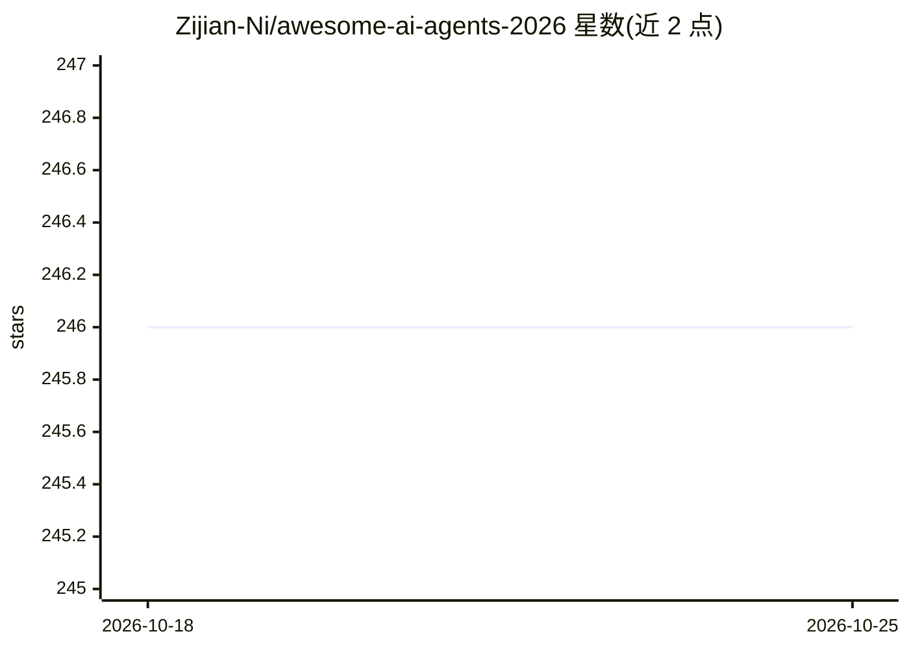

# Zijian-Ni/awesome-ai-agents-2026

⭐ 246 · Python · MIT · 推送 2026-10-08 · [GitHub](https://github.com/Zijian-Ni/awesome-ai-agents-2026) · 个人维护 · 中文 README

**2026 年 AI Agent 与模型生态策展清单（awesome list）**

面向 AI Agent 从业者与选型者的策展清单：按 30 个类别收录模型、agent 框架、协议（MCP/A2A）、编码 agent、安全、评测、中文生态等条目，含基础模型 245+、框架 55+、编码 agent 55+ 等。条目带成熟度状态标签（New/Archived/Stale/Unverified/Experimental 等），并提供场景指南（58 条）、技术栈配方（8 条）与 Anti-Picks（17 条）。清单本身不含可运行代码，目录条目为收录对象的信息。

## 筛选速览

| 维度 | 判定 | 备注 |
|---|---|---|
| AI 角色 | `ai-knowledge` | 知识聚合/清单类 |
| 许可风险 | `permissive` | MIT |
| 部署形态 | `None` |  |
| 模型依赖 | — | README 未给出锁定关系 |
| 硬件要求 | — | 无带数字的原话,不猜 |
| 安装摩擦 | `low` | 无编译、无系统依赖或容器化 |
| 成熟度 | — | 结构信号不足 |

## 能力要点

- 30 个类别组织条目，含基础模型、协议、框架、安全、评测与中文生态
- 条目带成熟度状态标签（New/Archived/Stale/Unverified/Experimental 等）
- 附场景指南 58 条、Stack Recipes 8 条、Anti-Picks 17 条

## 适用场景

- 按类别查找 2026 年的 agent 框架、工具与模型信息
- 通过场景指南与对比表选择工具组合
- 了解中文生态与值得关注的新增项目

## 场景标签

`精选清单` · 领域:学习与行业

## 证据(README 行号)

> L14: **A curated list of AI models, agent frameworks, tools, protocols, and resources for 2026 — the year agents went ma
> L52: |Category|Description|Count|

## 星数曲线

2026-10-18 246 → 2026-10-25 246（+0）

---
*卡片 v1 · prompt 1.4 · 生成 2026-10-22 · 置信度 high · 依据 README sha `f0a8457e901b` · [字段定义](../../DATASET.md)*
