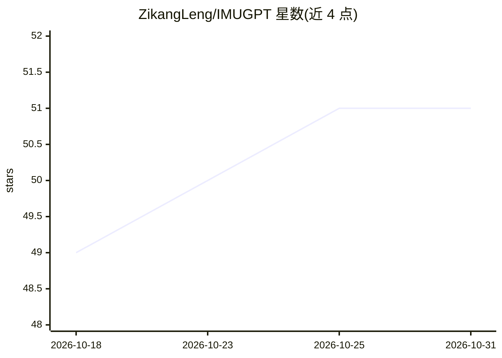

# ZikangLeng/IMUGPT

⭐ 51 · Tcl · Apache-2.0 · 推送 2026-10-28 · [GitHub](https://github.com/ZikangLeng/IMUGPT) · [官网](https://zikangleng.github.io/imugpt/) · 组织维护

**从文本描述生成虚拟 IMU 数据以训练行为识别模型**

Georgia Tech 团队的研究项目（ISWC 2023 Best Paper Honorable Mention、IMWUT 2024）：LLM 生成多样化活动描述，T2M-GPT 文本转 3D 人体运动，再经 SMPL 身体模型与 IMUSim 转为虚拟穿戴式 IMU 数据，用于训练人类行为识别（HAR）模型。2.0 版扩展至 5 数据集、5 LLM、4 运动合成模型与 3 分类器，并加入 LLM 运动过滤与多样性度量。通过 conda 环境+脚本安装，以 Jupyter notebook 流水线运行，prompt 生成需 OpenAI API key；SMPL 模型文件需自行注册下载。

## 筛选速览

| 维度 | 判定 | 备注 |
|---|---|---|
| AI 角色 | `ai-native` | 本体是模型或模型工具 |
| 许可风险 | `permissive` | Apache-2.0 |
| 部署形态 | `library` | 以包/库形式分发 |
| 模型依赖 | — | README 未给出锁定关系 |
| 硬件要求 | — | 无带数字的原话,不猜 |
| 安装摩擦 | `medium` | 含编译或系统依赖之一 |
| 成熟度 | — | 结构信号不足 |

## 能力要点

- LLM→文本转运动→虚拟 IMU 的三段生成流水线
- GPT-4 运动过滤器将错误序列从 35.5% 降至 9.9%
- 多样性饱和停止生成，节省至少 50% 生成开销
- 在 RealWorld/PAMAP2/USC-HAD 三个基准上 Real+Virtual 均提升准确率

## 适用场景

- 为 HAR 模型生成带标签的合成 IMU 训练数据
- 降低穿戴式传感数据采集成本（无需摄像头或录制）
- 研究生成数据与真实数据结合对行为识别的增益

## 场景标签

 · 领域:可穿戴计算/人类行为识别

## 证据(README 行号)

> L21: 1. A large language model writes many diverse descriptions of an activity.
> L23: 3. The motion is converted into virtual on-body IMU data that trains human activity recognition (HAR) models.

## 星数曲线

2026-10-18 49 → 2026-10-31 51（+2）

---
*卡片 v1 · prompt 1.4 · 生成 2026-10-24 · 置信度 high · 依据 README sha `5e455e8b8e4e` · [字段定义](../../DATASET.md)*
