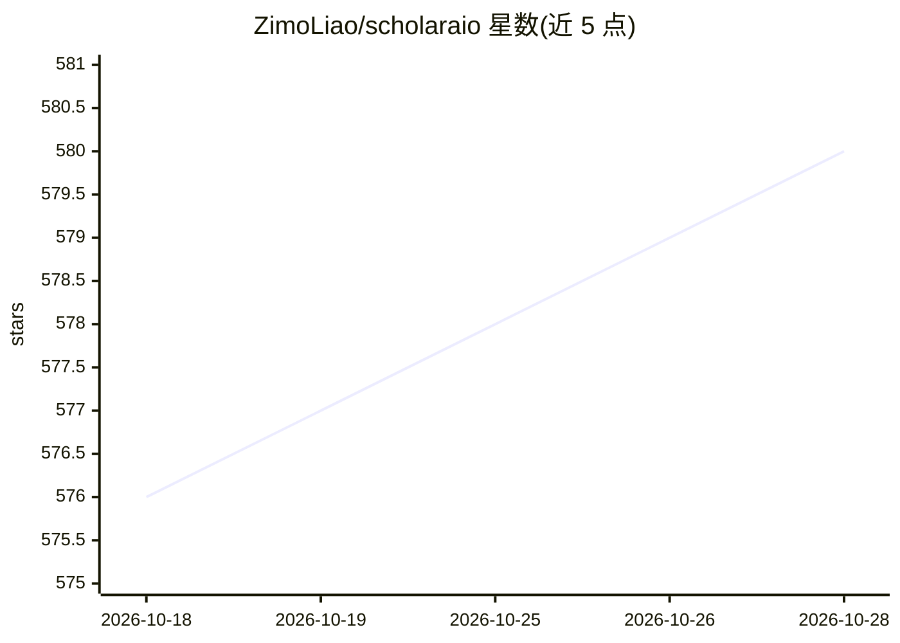

# ZimoLiao/scholaraio

⭐ 580 · Python · MIT · 推送 2026-10-27 · [GitHub](https://github.com/ZimoLiao/scholaraio) · [官网](https://zimoliao.github.io/scholaraio/) · 个人维护 · 中文 README

**为 AI 编程 agent 提供学术研究全流程的文献管理基座**

面向 AI 编码 agent 的学术研究基础设施（harness）：以 CLI 与技能包形式为 agent 提供稳定的学术操作契约，覆盖 PDF 解析入库、关键词+语义混合检索、引文图谱、主题发现、本地文献库 WebUI、多源导入（Zotero/Endnote/arXiv）与 BibTeX/RIS/DOCX 导出，以及文献综述、论文写作、审稿回复等路由式学术写作流程，引文均可溯源到本地文献库。兼容 Claude Code、Codex、Cline、Qwen、Cursor 等多种 agent，LLM API key 与 MinerU token 均为可选。

## 筛选速览

| 维度 | 判定 | 备注 |
|---|---|---|
| AI 角色 | `ai-ecosystem` | LLM/agent 周边工具 |
| 许可风险 | `permissive` | MIT |
| 部署形态 | `library` | 以包/库形式分发 |
| 模型依赖 | — | README 未给出锁定关系 |
| 硬件要求 | — | 无带数字的原话,不猜 |
| 安装摩擦 | `low` | 无编译、无系统依赖或容器化 |
| 成熟度 | — | 结构信号不足 |

## 能力要点

- 论文库转为 agent 可复用的知识库（PDF→结构化 Markdown，关键词+语义混合检索）
- 兼容 Claude Code/Codex/Cline/Qwen/Cursor/Windsurf/Copilot 等多种 agent 的技能与插件集成
- 路由式学术写作工作流：综述、单篇精读、论文各节、审稿回复、海报等，引文可溯源
- 本地文献库 WebUI：检索、BibTeX 引用、内联阅读 PDF、阅读行为分析

## 适用场景

- 用我的编码 agent 管理和检索本地论文库并完成文献综述
- 把 Zotero/Endnote 现有文献库连同 PDF 迁移到 agent 可用的知识库
- 让 agent 基于自己文献库完成论文写作与引文核查

## 场景标签

`科研工具` `文档解析` · 领域:知识与检索

## 证据(README 行号)

> L12: Your coding agent already reasons, plans, browses, writes code, and uses tools. ScholarAIO adds the academic harnes
> L18: Here, **All-in-One means one coherent academic workflow**, not every scientific package in one distribution. The ac
> L98: |Agent / IDE|Open this repo directly|Reuse from another project|

## 星数曲线

2026-10-18 576 → 2026-10-28 580（+4）

---
*卡片 v1 · prompt 1.4 · 生成 2026-10-21 · 置信度 high · 依据 README sha `36327ffd6f20` · [字段定义](../../DATASET.md)*
