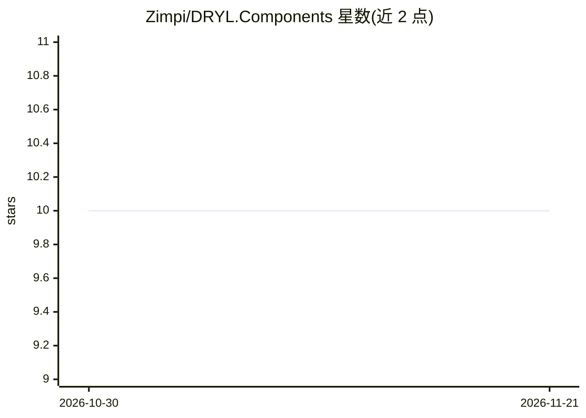

# Zimpi/DRYL.Components

⭐ 10 · C# · MIT · 推送 2026-11-19 · [GitHub](https://github.com/Zimpi/DRYL.Components) · [官网](https://components.dryl.dev) · 个人维护

**面向 Blazor 开发者的带 AI 状态视觉语言的 UI 组件库**

为 Blazor Server 与 Blazor WebAssembly 提供约 90 个组件的 UI 库，零 npm 依赖，仅由 CSS、Razor 与单个手写 interop 文件构成。核心机制是每个可承载 AI 内容的组件接受统一的 `Ai` 参数，驱动六种状态（None/Active/Thinking/Streaming/Generated/Proposed）对应的共享视觉词汇，如旋转渐变边框、脉冲发光、一次性揭示；并通过 aria-live 播报 AI 活动。主题系统由少量种子色派生整套配色，支持运行时切换。目标 .NET 8/9/10。

## 筛选速览

| 维度 | 判定 | 备注 |
|---|---|---|
| AI 角色 | `ai-enhanced` | 去掉 AI 部分产品仍成立 |
| 许可风险 | `permissive` | MIT |
| 部署形态 | `None` |  |
| 模型依赖 | — | README 未给出锁定关系 |
| 硬件要求 | — | 无带数字的原话,不猜 |
| 安装摩擦 | `medium` | 含编译或系统依赖之一 |
| 成熟度 | `idea` | |

## 能力要点

- 每个组件接受单一 `Ai` 参数，六种 AI 状态共享统一视觉词汇
- 约 90 个组件，零 npm 依赖，仅 CSS + Razor + 单个 interop 文件
- 种子色派生主题系统，支持运行时切换并含专属 AI 强调色
- 键盘可达、ARIA 标注，AI 活动通过 aria-live 播报

## 适用场景

- 为 Blazor SaaS 应用构建带 AI 流式输出指示的界面
- 统一管理聊天面板、工具调用等 AI 界面状态的可视化反馈
- 用种子色快速派生一致的明暗主题配色

## 场景标签

 · 领域:软件开发/UI 组件库

## 证据(README 行号)

> L13: **An AI-Native, Zero-NPM, Glassmorphic UI Component Library for Blazor.**
> L27: - **AI-native.** Every AI-capable surface accepts a single `Ai` parameter that drives a shared visual vocabulary — 
> L105: Every surface that can carry AI-generated content accepts a single `Ai` parameter of type `AiState`. That paramete

## 星数曲线

2026-10-30 10 → 2026-11-21 10（+0）

---
*卡片 v1 · prompt 1.4 · 生成 2026-11-20 · 置信度 high · 依据 README sha `e6f7caef6ad3` · [字段定义](../../DATASET.md)*
