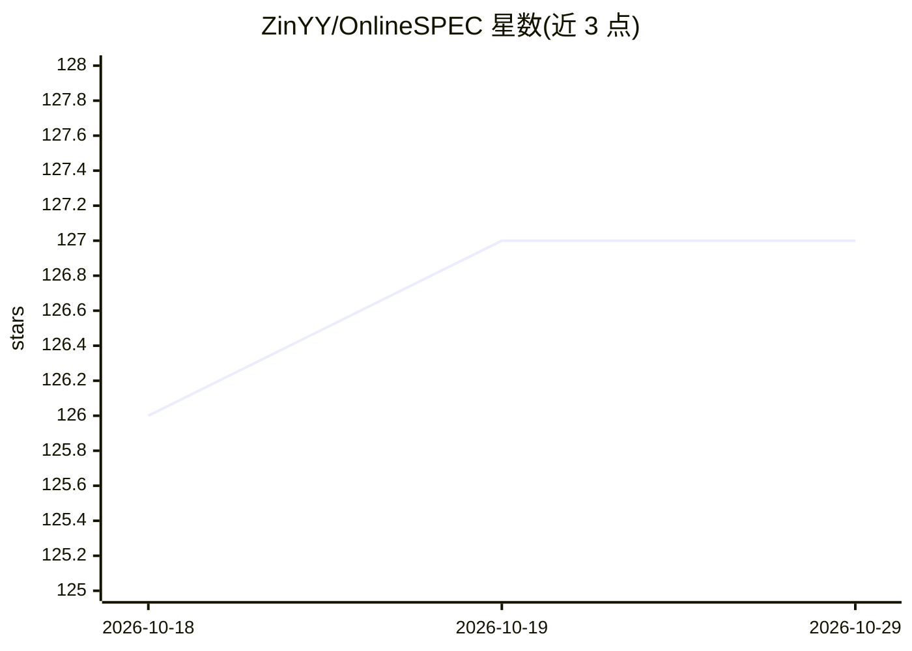

# ZinYY/OnlineSPEC

⭐ 127 · Python · 推送 2026-07-27 · [GitHub](https://github.com/ZinYY/OnlineSPEC) · [官网](https://arxiv.org/abs/2603.12617) · 组织维护

**ICML'26 论文官方实现：用在线学习持续进化投机解码的草稿模型**

论文 When Drafts Evolve: Speculative Decoding Meets Online Learning 的官方实现，将投机解码形式化为在线学习问题，在验证阶段利用反馈信号持续更新草稿模型，并建立 regret 界与加速比的理论联系。仓库为多项目工作区，含三个实例：Ens-EAGLE/Ens-EAGLE-3（多学习率草稿模型在线集成）、Opt-Hydra（动量乐观在线更新 Hydra 头）、Online-LR（Lookahead Reasoning 的在线 DPO）。提供模型/数据准备、conda 环境与训练评估脚本，主要面向复现实验的科研用户。

## 筛选速览

| 维度 | 判定 | 备注 |
|---|---|---|
| AI 角色 | `ai-native` | 本体是模型或模型工具 |
| 许可风险 | `none` | — |
| 部署形态 | `library` | 以包/库形式分发 |
| 模型依赖 | — | README 未给出锁定关系 |
| 硬件要求 | — | 无带数字的原话,不猜 |
| 安装摩擦 | `low` | 无编译、无系统依赖或容器化 |
| 成熟度 | — | 结构信号不足 |

## 能力要点

- 三个实例：Ens-EAGLE/Ens-EAGLE-3、Opt-Hydra、Online-LR
- 验证阶段反馈信号驱动的草稿模型在线更新
- 提供完整的模型下载、数据准备与复现脚本（conda 环境 + shell 脚本）

## 适用场景

- 复现论文中投机解码加速实验
- 在自己的数据流上在线微调投机解码草稿模型
- 研究在线学习与 speculative decoding 结合的方法

## 场景标签

`科研工具` · 领域:学习与行业

## 证据(README 行号)

> L7: This is the official implementation of the paper When Drafts Evolve: Speculative Decoding Meets Online Learning (**I
> L17: ***OnlineSPEC*** is a unified framework that integrates speculative decoding with online learning to achieve enhanc
> L19: This repository contains implementations of three key approaches:

## 星数曲线

2026-10-18 126 → 2026-10-29 127（+1）

---
*卡片 v1 · prompt 1.4 · 生成 2026-10-23 · 置信度 mid · 依据 README sha `8823763d49aa` · [字段定义](../../DATASET.md)*
