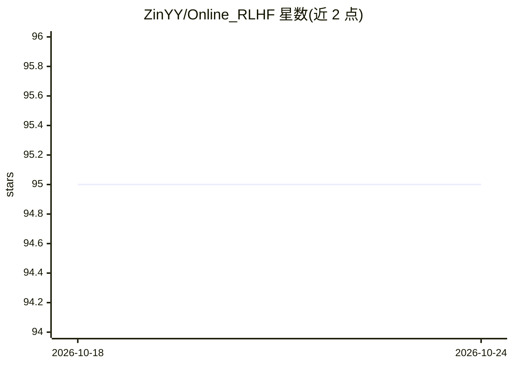

# ZinYY/Online_RLHF

⭐ 95 · Python · 推送 2026-10-24 · [GitHub](https://github.com/ZinYY/Online_RLHF) · [官网](https://arxiv.org/abs/2502.07193) · 个人维护

**NeurIPS'25 论文的 Online RLHF 训练流程 PyTorch 实现**

论文 "Provably Efficient Online RLHF with One-Pass Reward Modeling" 的官方 PyTorch 实现，fork 自 OpenRLHF 修改而来。以“配方”方式组织 Online RLHF 训练：将 SFT、奖励模型训练（regular/HVP）、PPO/DPO、生成、评估等步骤组合为可编排的训练流水线，支持被动阶段训练与部署时在线自适应两种运行方式。面向需要复现论文或开展 LLM 后训练研究的使用者，依赖 PyTorch、transformers 4.46.3、DeepSpeed 等，需多 GPU 环境。

## 筛选速览

| 维度 | 判定 | 备注 |
|---|---|---|
| AI 角色 | `ai-ecosystem` | LLM/agent 周边工具 |
| 许可风险 | `none` | — |
| 部署形态 | `library` | 以包/库形式分发 |
| 模型依赖 | — | README 未给出锁定关系 |
| 硬件要求 | — | 无带数字的原话,不猜 |
| 安装摩擦 | `low` | 无编译、无系统依赖或容器化 |
| 成熟度 | — | 结构信号不足 |

## 能力要点

- SFT/RM/PPO/DPO/生成/评估等组件可按 recipe 自由编排
- 支持 regular 与 HVP 两种奖励模型类型
- 提供被动阶段与部署时在线自适应两套运行流程
- 多种奖励模型数据选取策略（best_worst/best_second/best_quartile/random）

## 适用场景

- 复现论文中的 Online RLHF 实验流程
- 研究 LLM 后训练中奖励建模与 PPO/DPO 的组合方式
- 在自有数据集上编排自定义 RLHF 训练流水线

## 场景标签

`强化学习` `微调` · 领域:训练与推理

## 证据(README 行号)

> L3: A PyTorch implementation of the NeurIPS'25 paper "Provably Efficient Online RLHF with One-Pass Reward Modeling". Thi
> L5: This repository is forked from OpenRLHF repo, and modified to implement our Online RLHF Pipeline.

## 星数曲线

2026-10-18 95 → 2026-10-24 95（+0）

---
*卡片 v1 · prompt 1.4 · 生成 2026-10-23 · 置信度 mid · 依据 README sha `3aebdf849bc0` · [字段定义](../../DATASET.md)*
