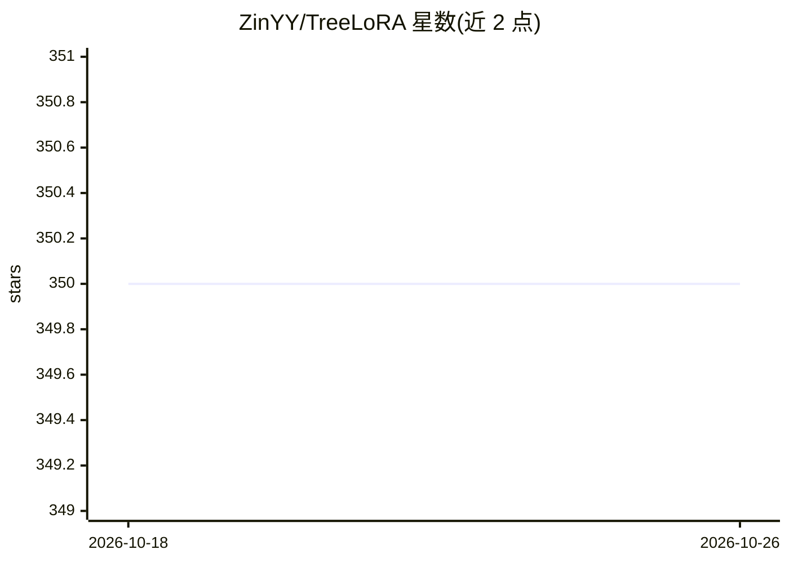

# ZinYY/TreeLoRA

⭐ 350 · Python · 推送 2025-12-15 · [GitHub](https://github.com/ZinYY/TreeLoRA) · [官网](https://arxiv.org/abs/2506.10355) · 组织维护

**ICML 2025 论文 TreeLoRA 的 PyTorch 官方实现：LLM 高效持续学习**

论文 "TreeLoRA: Efficient Continual Learning via Layer-Wise LoRAs Guided by a Hierarchical Gradient-Similarity Tree" 的官方 PyTorch 实现，面向 LLM 持续学习场景：通过层级梯度相似度树组织逐层 LoRA 适配器。支持 Gemma/LLaMA/Mistral 等多种架构，集成 DeepSpeed 与 Flash Attention，提供 24 个任务（TRACE-LLM 与 O-LoRA 数据集混合）的 LLM-CL-Benchmark 训练评估脚本。用户需自行准备数据与 HuggingFace 预训练模型，按 requirements.txt 安装依赖后以 bash 脚本运行实验。

## 筛选速览

| 维度 | 判定 | 备注 |
|---|---|---|
| AI 角色 | `ai-ecosystem` | LLM/agent 周边工具 |
| 许可风险 | `none` | — |
| 部署形态 | `library` | 以包/库形式分发 |
| 模型依赖 | — | README 未给出锁定关系 |
| 硬件要求 | — | 无带数字的原话,不猜 |
| 安装摩擦 | `medium` | 含编译或系统依赖之一 |
| 成熟度 | — | 结构信号不足 |

## 能力要点

- 层级梯度相似度树引导的逐层 LoRA 适配器
- 支持 Gemma、LLaMA、Mistral 等多种 LLM 架构
- DeepSpeed 集成与 Flash Attention 实现
- 包含 24 任务 LLM 持续学习基准与一键全量实验脚本

## 适用场景

- 复现论文中的 LLM 持续学习实验
- 在非平稳任务序列上训练 LoRA 适配器并评估
- 基于代码开展持续学习方法的进一步研究

## 场景标签

`微调` · 领域:训练与推理

## 证据(README 行号)

> L3: This repository contains the official PyTorch implementation of TreeLoRA, an efficient continual learning method for
> L79: - Efficient continual learning through layer-wise LoRA adapters
> L81: - Support for multiple LLM architectures (Gemma, LLaMA, Mistral, etc.)

## 星数曲线

2026-10-18 350 → 2026-10-26 350（+0）

---
*卡片 v1 · prompt 1.4 · 生成 2026-10-22 · 置信度 mid · 依据 README sha `ed500038766f` · [字段定义](../../DATASET.md)*
