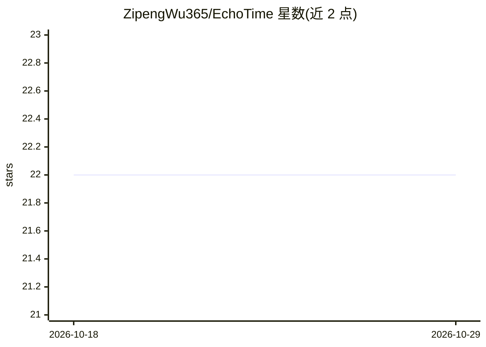

# ZipengWu365/EchoTime

⭐ 22 · Python · MIT · 推送 2026-10-28 · [GitHub](https://github.com/ZipengWu365/EchoTime) · [官网](https://zipengwu365.github.io/EchoTime/) · 个人维护

**可解释时间序列结构相似度比较库，输出 HTML 报告与 agent JSON**

面向人类与 agent 的时间序列/时序数据集相似度比较 Python 库：比较两条曲线或两个数据集的结构相似性，给出 plain-English 摘要、组件分解（形状/趋势/频谱）与滚动相似度，并生成可分享 HTML 报告和带稳定成功/错误信封的紧凑 JSON。弹性相似度函数支持 exact/fast 两种模式与 window 约束，保留不规则时间戳的间隙。提供 ts_profile/ts_compare/ts_route 等 agent 调用封装（OpenAI function schema、MCP 工具描述符），并声明不做预测、分类与子序列挖掘。由伯明翰大学个人维护者以 PyPI 包 pip install echotime 分发，自标 Beta 状态。

## 筛选速览

| 维度 | 判定 | 备注 |
|---|---|---|
| AI 角色 | `ai-ecosystem` | LLM/agent 周边工具 |
| 许可风险 | `permissive` | MIT |
| 部署形态 | `library` | 以包/库形式分发 |
| 模型依赖 | — | README 未给出锁定关系 |
| 硬件要求 | — | 无带数字的原话,不猜 |
| 安装摩擦 | `low` | 无编译、无系统依赖或容器化 |
| 成熟度 | `idea` | |

## 能力要点

- 时间序列与数据集级结构比较及可解释摘要（形状/趋势/频谱组件）
- 可分享 HTML 报告与 agent-ready JSON（稳定信封）
- 弹性相似度（EDR/ERP/TWED 等）支持 exact/fast 模式与 window 约束
- ts_profile/ts_compare/ts_route 封装，附 OpenAI function schema 与 MCP 工具描述符

## 适用场景

- 判断两条曲线是否足够相似以便对比分析
- 评估两个数据集结构是否相似以迁移经验
- 为 agent/函数调用流程提供可解释的相似度判定与报告

## 场景标签

`数据分析` · 领域:效率与自动化

## 证据(README 行号)

> L18: **EchoTime** is an **explainable time-series similarity package for humans and agents.** It is built for the moment
> L203: All wrappers ship an explicit input contract and a stable success/error envelope. They are meant to be the smalles
> L209: - MCP tool descriptors

## 星数曲线

2026-10-18 22 → 2026-10-29 22（+0）

---
*卡片 v1 · prompt 1.4 · 生成 2026-10-27 · 置信度 high · 依据 README sha `4c13750d301c` · [字段定义](../../DATASET.md)*
