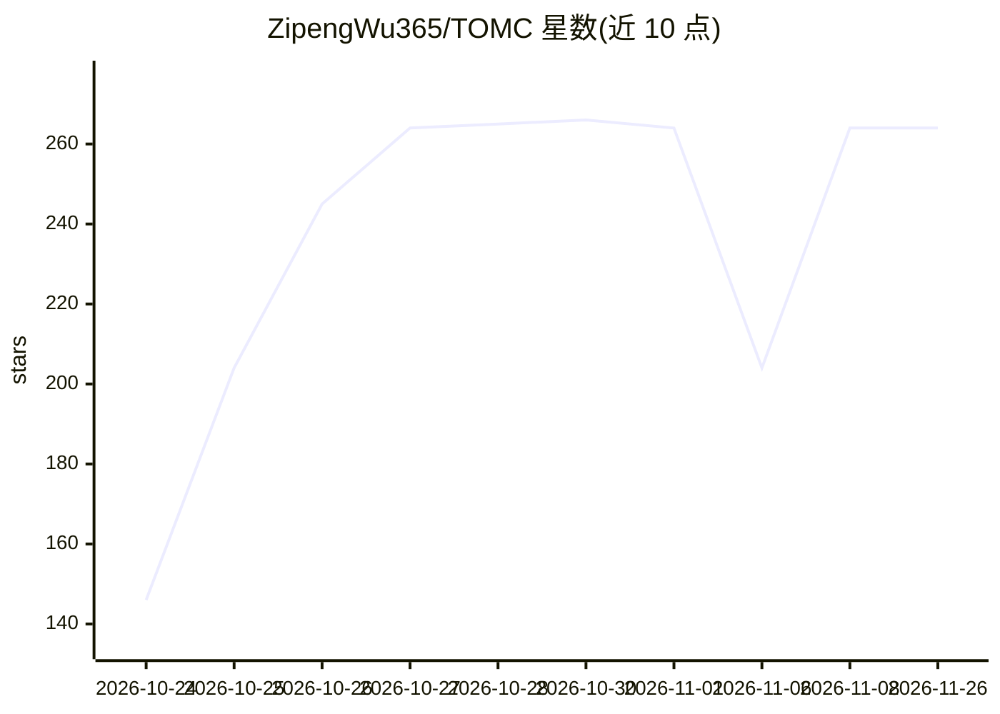

# ZipengWu365/TOMC

⭐ 264 · Python · MIT · 推送 2026-11-25 · [GitHub](https://github.com/ZipengWu365/TOMC) · [官网](https://github.com/ZipengWu365/TOMC) · 个人维护 · 中文 README

**面向 AI 编程助手的上下文压缩与任务记忆 MCP 服务器**

以 MCP 服务器与 Python 库形式提供的上下文压缩工具：对用户提交的历史对话按预算保留最新事实值（如框架从 Flask 变更到 Litestar 后只返回最新值），并提供 remember_memory/forget_memory 的本地任务记忆（存于 ~/.tomc/memory.sqlite3）。支持 Claude Code、Codex 插件安装，以及任意 MCP 客户端的源码接入。README 明确限制：不压缩助手当前会话、短历史收益有限、基于词匹配可能漏检改写更新，部分客户端未经实机验证。

## 筛选速览

| 维度 | 判定 | 备注 |
|---|---|---|
| AI 角色 | `ai-ecosystem` | LLM/agent 周边工具 |
| 许可风险 | `permissive` | MIT |
| 部署形态 | `desktop` | 安装包/桌面程序 |
| 模型依赖 | — | README 未给出锁定关系 |
| 硬件要求 | — | 无带数字的原话,不猜 |
| 安装摩擦 | `low` | 无编译、无系统依赖或容器化 |
| 成熟度 | `idea` | |

## 能力要点

- 按预算压缩历史对话，事实变更时只保留最新值并附来源行
- 本地任务记忆存储于 ~/.tomc/memory.sqlite3，支持单条或全部清除
- 提供 Claude Code/Codex 插件与任意 MCP 客户端的接入方式
- 离线基准可复现（make reproduce），并公开证据清单与负面结果

## 适用场景

- 让编程助手在长项目历史中拿到最新的技术决策而非旧版本
- 在 Codex 与 Claude Code 之间切换时保留任务记忆
- 减少提交给模型的历史输入量

## 场景标签

`Agent 记忆` · 领域:Agent 开发

## 证据(README 行号)

> L5: ZipengWu365/TOMC MCP server
> L70: prepared = prepare_context(history, task)

## 星数曲线

2026-10-24 146 → 2026-11-26 264（+118）

---
*卡片 v1 · prompt 1.4 · 生成 2026-11-26 · 置信度 high · 依据 README sha `356fc7aa50c5` · [字段定义](../../DATASET.md)*
