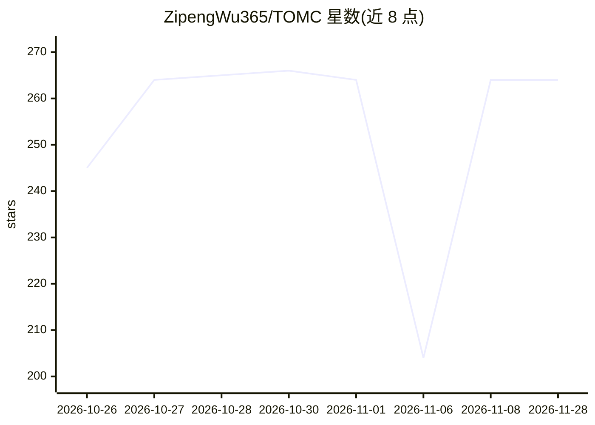

# ZipengWu365/TOMC

⭐ 264 · Python · MIT · 推送 2026-11-27 · [GitHub](https://github.com/ZipengWu365/TOMC) · [官网](https://github.com/ZipengWu365/TOMC) · 个人维护 · 中文 README

**为 MCP 客户端提供上下文压缩与任务记忆的服务器**

以 MCP 服务器形式为 Codex、Claude Code、Cursor 等 AI 编码助手提供历史上下文压缩与任务记忆：prepare_context 压缩用户提交的历史并保留变化事实的最新值（如 framework = Litestar），remember_memory 将笔记存入本地 SQLite（~/.tomc/memory.sqlite3）。默认预算保留 80%（10K）滑至 60%（1M）token。限制：不缩减客户端已在进行的对话，基于词匹配非语义，短历史收益约 10–20%，论文未公开，仅 Codex 与 Claude Code 经真实模型调用验证。

## 筛选速览

| 维度 | 判定 | 备注 |
|---|---|---|
| AI 角色 | `ai-ecosystem` | LLM/agent 周边工具 |
| 许可风险 | `permissive` | MIT |
| 部署形态 | `desktop` | 安装包/桌面程序 |
| 模型依赖 | — | README 未给出锁定关系 |
| 硬件要求 | — | 无带数字的原话,不猜 |
| 安装摩擦 | `low` | 无编译、无系统依赖或容器化 |
| 成熟度 | `idea` | |

## 能力要点

- prepare_context/prepare.messages 直接替换旧历史发送，含 STATE? 待核标记机制
- 本地 SQLite 记忆存储，支持 forget_memory 与 tomc erase-all 删除
- 自带离线回归检查（make reproduce，144 题，无模型调用）
- 支持 Claude Code 插件、Codex 安装器与任意 MCP 客户端源码接入

## 适用场景

- 在 Codex/Claude Code 中让助手记住项目决策的最新版本
- 长项目历史发送前压缩输入以减少 token
- 跨助手迁移并保留已保存的任务笔记

## 场景标签

`Agent 记忆` · 领域:Agent 开发

## 证据(README 行号)

> L5: ZipengWu365/TOMC MCP server
> L23: 1. **It does not shrink the chat your assistant is already having.** Claude Code and Codex manage their own chat. T

## 星数曲线

2026-10-26 245 → 2026-11-28 264（+19）

---
*卡片 v1 · prompt 1.4 · 生成 2026-11-28 · 置信度 high · 依据 README sha `8b55ca74af1f` · [字段定义](../../DATASET.md)*
