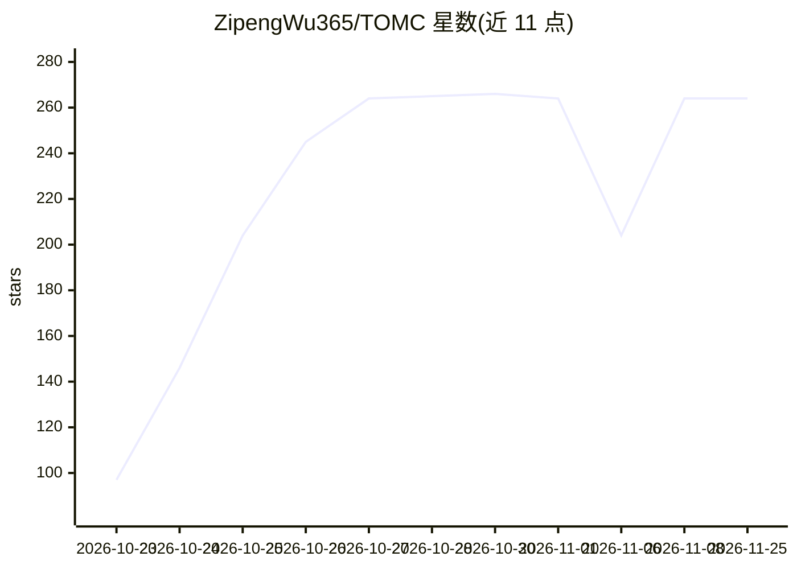

# ZipengWu365/TOMC

⭐ 264 · Python · MIT · 推送 2026-11-23 · [GitHub](https://github.com/ZipengWu365/TOMC) · [官网](https://github.com/ZipengWu365/TOMC) · 个人维护 · 中文 README

**给 Codex/Claude Code 等 MCP 客户端提供上下文压缩与任务记忆**

以 MCP 服务器与 Python API 形式提供的任务型记忆编译工具：对用户交给它的历史记录按预算压缩，保留变更事实的最新值及其来源行，改写后的值标注 STATE? 供人工核对；用户可用 remember_memory/forget_memory 在本地 SQLite 中保存与删除笔记。提供 Claude Code 插件、Codex 安装器、通用 MCP 客户端源码安装三条路径，并有离线自测与桌面伴侣（beta，Windows/macOS）。限制：不缩小客户端正在进行的对话，短历史收益小，基于词匹配而非语义匹配，部分客户端未经真机验证。

## 筛选速览

| 维度 | 判定 | 备注 |
|---|---|---|
| AI 角色 | `ai-ecosystem` | LLM/agent 周边工具 |
| 许可风险 | `permissive` | MIT |
| 部署形态 | `desktop` | 安装包/桌面程序 |
| 模型依赖 | — | README 未给出锁定关系 |
| 硬件要求 | — | 无带数字的原话,不猜 |
| 安装摩擦 | `low` | 无编译、无系统依赖或容器化 |
| 成熟度 | `idea` | |

## 能力要点

- 任务型记忆编译：变更事实只保留最新值并附来源行
- MCP 服务器接入 Codex、Claude Code、Cursor、TRAE、WorkBuddy 等客户端
- 本地 SQLite 存储笔记，提供 erase-all 等删除命令
- 离线自测可通过 make reproduce 复现

## 适用场景

- 跨会话保留项目决策的最新状态，避免向新对话重复交代背景
- 压缩长项目历史以减少请求输入量
- 在不同助手之间迁移并保留已有笔记

## 场景标签

`Agent 记忆` · 领域:Agent 开发

## 证据(README 行号)

> L1: TOMC Memory
> L21: 1. **It does not shrink the chat your assistant is already having.** Claude Code and Codex manage their own chat. T
> L52: ### Any MCP client (Cursor, Claude Desktop, WorkBuddy, TRAE …)

## 星数曲线

2026-10-23 97 → 2026-11-25 264（+167）

---
*卡片 v1 · prompt 1.4 · 生成 2026-11-25 · 置信度 high · 依据 README sha `9845b8c3914b` · [字段定义](../../DATASET.md)*
