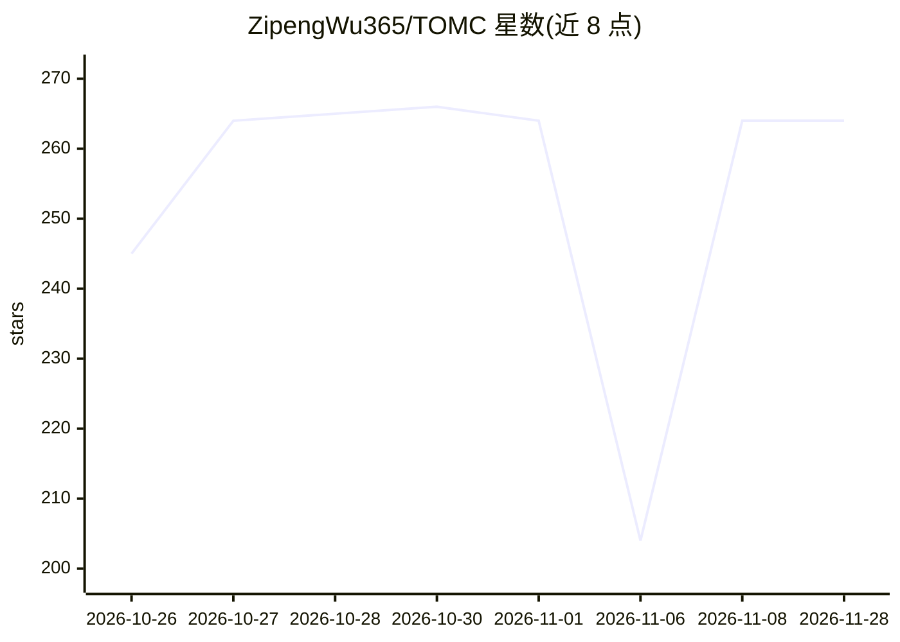

# ZipengWu365/TOMC

⭐ 264 · Python · MIT · 推送 2026-11-27 · [GitHub](https://github.com/ZipengWu365/TOMC) · [官网](https://github.com/ZipengWu365/TOMC) · 个人维护 · 中文 README

**为 MCP 客户端提供 CPU 上下文压缩与任务记忆**

以 MCP server 形式运行的上下文压缩与任务记忆工具：对用户交给它的历史对话与笔记做基于词匹配的压缩，保留变更事实的最新值并附来源行，存入本地 sqlite3。通过 Claude Code 插件、Codex 安装包或源码方式接入 MCP 客户端，压缩不作用于客户端自管的当前对话。约 10K token 以下短历史收益有限，改写式更新可能漏检并标记 STATE? 供人工核查。

## 筛选速览

| 维度 | 判定 | 备注 |
|---|---|---|
| AI 角色 | `ai-ecosystem` | LLM/agent 周边工具 |
| 许可风险 | `permissive` | MIT |
| 部署形态 | `desktop` | 安装包/桌面程序 |
| 模型依赖 | — | README 未给出锁定关系 |
| 硬件要求 | — | 无带数字的原话,不猜 |
| 安装摩擦 | `low` | 无编译、无系统依赖或容器化 |
| 成熟度 | `idea` | |

## 能力要点

- 保留变更事实最新值并附来源行，旧值不回传
- 本地 sqlite3 存储，支持 forget_memory/erase-all 删除
- 提供 Python API prepare_context 与离线示例 tomc try
- 内置 tomc doctor 自检与客户端配置备份写入

## 适用场景

- 让编程助手记住项目决策的当前版本而不必重复解释
- 长历史对话下压缩发给模型的输入 token
- 在 Codex 与 Claude Code 之间保留并延续任务笔记

## 场景标签

`Agent 记忆` · 领域:Agent 开发

## 证据(README 行号)

> L5: ZipengWu365/TOMC MCP server
> L23: 1. **It does not shrink the chat your assistant is already having.** Claude Code and Codex manage their own chat. T
> L54: ### Any MCP client (Cursor, Claude Desktop, WorkBuddy, TRAE …)

## 星数曲线

2026-10-26 245 → 2026-11-28 264（+19）

---
*卡片 v1 · prompt 1.4 · 生成 2026-11-27 · 置信度 high · 依据 README sha `6cca5ce26f27` · [字段定义](../../DATASET.md)*
