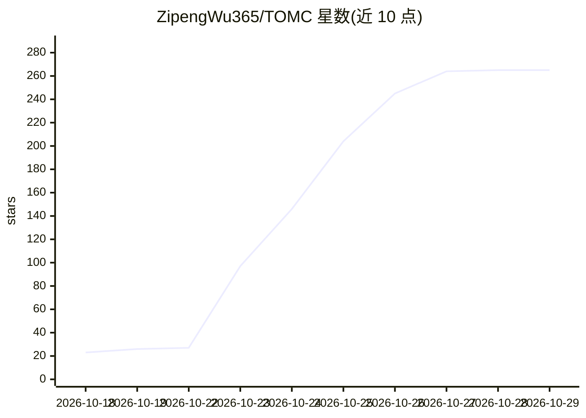

# ZipengWu365/TOMC

⭐ 265 · Python · MIT · 推送 2026-10-28 · [GitHub](https://github.com/ZipengWu365/TOMC) · [官网](https://github.com/ZipengWu365/TOMC) · 个人维护 · 中文 README

**面向 AI 编程助手的 CPU 上下文压缩与任务记忆工具**

基于任务导向记忆编译（TOMC）的开源工具，通过 MCP 服务器与 Python API 两种形式提供：给定历史、下一任务与内存预算，选取源文本并生成状态/关系/计数记录，替代完整历史发送给助手；另支持 remember_memory/recall_memory 显式保存与召回任务笔记。准备过程在 CPU 运行，无需训练或额外模型服务。支持 Codex、Claude Code、Cursor、TRAE、WorkBuddy、Claude Desktop 等客户端集成。当前为 0.1.0 研究预览版，无 PyPI 包，宿主管理会话时不主动重压缩。

## 筛选速览

| 维度 | 判定 | 备注 |
|---|---|---|
| AI 角色 | `ai-ecosystem` | LLM/agent 周边工具 |
| 许可风险 | `permissive` | MIT |
| 部署形态 | `desktop` | 安装包/桌面程序 |
| 模型依赖 | — | README 未给出锁定关系 |
| 硬件要求 | `cpu-ok` | |
| 安装摩擦 | `medium` | 含编译或系统依赖之一 |
| 成熟度 | `idea` | |

## 能力要点

- 上下文压缩在 CPU 运行，无需训练或额外模型服务
- 显式 remember_memory / recall_memory 任务笔记保存与召回
- 跨助手复用同一本地 TOMC 数据库中的任务笔记
- 提供 MCP 服务器与 Python API 两种接入形式

## 适用场景

- 压缩长会话历史以减小发送给 AI 助手的请求
- 在新会话或其他助手中召回已保存的任务决策与待办
- 跨 Codex 与 Claude Code 交接任务时携带笔记

## 场景标签

`Agent 记忆` · 领域:Agent 开发

## 证据(README 行号)

> L22: **TOMC Memory** is an open-source tool built on Task-Oriented Memory Compilation (TOMC). It compresses and compiles
> L107: |Client|Start here|Prerequisites|

## 星数曲线

2026-10-18 23 → 2026-10-29 265（+242）

---
*卡片 v1 · prompt 1.4 · 生成 2026-10-23 · 置信度 mid · 依据 README sha `1f2796aa5484` · [字段定义](../../DATASET.md)*
