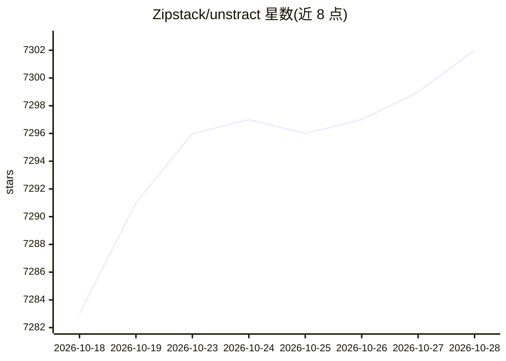

# Zipstack/unstract

⭐ 7,347 · Python · AGPL-3.0 · 推送 2026-10-28 · [GitHub](https://github.com/Zipstack/unstract) · [官网](https://unstract.com) · 组织维护

**用 LLM 从非结构化文档抽取结构化 JSON 的平台，面向金融/保险/医疗团队**

Unstract 通过自然语言 prompt 定义抽取 schema，用 LLM 从 PDF、图片、扫描件等文档生成结构化 JSON，可部署为 REST API 或 ETL 管道（源含 S3/GCS/Dropbox 等，目标含 Snowflake/BigQuery 等）。提供 Prompt Studio 界面、MCP Server 供 AI agent 接入、n8n 节点。支持 OpenAI/Anthropic/Bedrock/Ollama 等多种 LLM 提供商，本地运行需 Linux/macOS、Docker 与 8GB 内存，通过 git clone 加 run-platform.sh 启动。另有付费云/企业版（SSO、SOC 2 等）。

## 筛选速览

| 维度 | 判定 | 备注 |
|---|---|---|
| AI 角色 | `ai-native` | 本体是模型或模型工具 |
| 许可风险 | `viral` | AGPL-3.0 |
| 部署形态 | `self-host` | docker 或自建部署 |
| 模型依赖 | local-ok | 支持本地模型 |
| 硬件要求 | — | 无带数字的原话,不猜 |
| 安装摩擦 | `low` | 无编译、无系统依赖或容器化 |
| 成熟度 | — | 结构信号不足 |

## 能力要点

- 自然语言 prompt 定义抽取 schema，输出 JSON
- REST API 部署与 ETL 管道（多种云存储源与数据仓库目标）
- 支持 OpenAI/Anthropic/Bedrock/Ollama 等 LLM 提供商及多种向量库
- 提供 MCP Server 与 n8n 节点接入自动化流程

## 适用场景

- 把 KYC/发票等 PDF 批量转为结构化数据入仓库
- 在 ETL 流水线中自动抽取文档字段
- 通过 API 向业务系统提供文档抽取服务

## 场景标签

`文档解析` · 领域:知识与检索

## 证据(README 行号)

> L27: Unstract uses LLMs to extract structured JSON from documents — PDFs, images, scans, you name it. Define what you wa
> L29: Built for teams in **finance**, **insurance**, **healthcare**, **KYC/compliance**, and much more.
> L51: **API Deployment** — Send a document over REST API, get JSON back. Docs →

## 星数曲线

2026-10-18 7,283 → 2026-10-28 7,302（+19）

---
*卡片 v1 · prompt 1.4 · 生成 2026-10-20 · 置信度 high · 依据 README sha `f9c835bc2221` · [字段定义](../../DATASET.md)*
