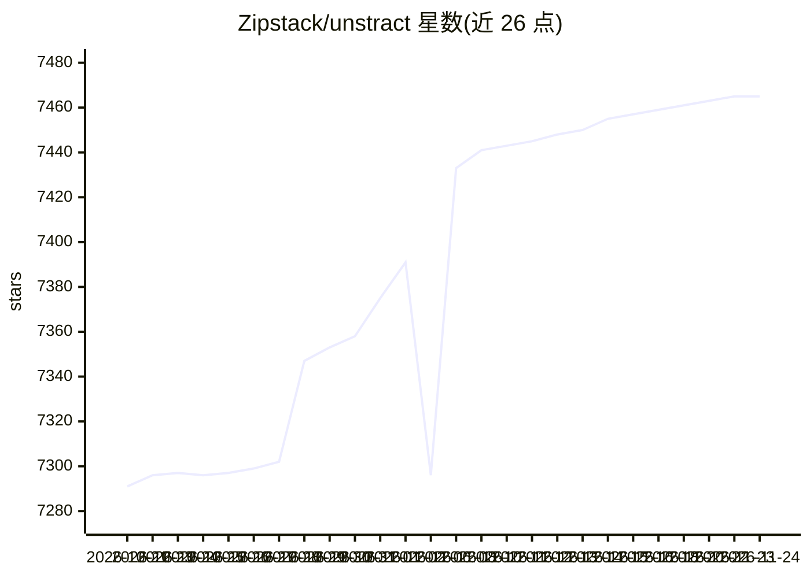

# Zipstack/unstract

⭐ 7,465 · Python · AGPL-3.0 · 推送 2026-11-22 · [GitHub](https://github.com/Zipstack/unstract) · [官网](https://unstract.com) · 组织维护

**用 LLM 将非结构化文档抽取为结构化 JSON 的平台**

Unstract 是一个文档抽取平台：通过自然语言提示定义抽取模式，将 PDF、图片、扫描件等文档转为结构化 JSON，可部署为 REST API 或 ETL 流水线。提供 Prompt Studio 定义抽取模式、MCP Server 连接 AI agents、n8n 节点接入自动化流程；支持多种 LLM 提供商、向量数据库、文本抽取器与数据仓库目的地。本地部署需 Docker Compose 与至少 8 GB 内存；另有面向企业的云托管版本。

## 筛选速览

| 维度 | 判定 | 备注 |
|---|---|---|
| AI 角色 | `ai-native` | 本体是模型或模型工具 |
| 许可风险 | `viral` | AGPL-3.0 |
| 部署形态 | `self-host` | docker 或自建部署 |
| 模型依赖 | local-ok | 支持本地模型 |
| 硬件要求 | — | 无带数字的原话,不猜 |
| 安装摩擦 | `low` | 无编译、无系统依赖或容器化 |
| 成熟度 | — | 结构信号不足 |

## 能力要点

- Prompt Studio 用自然语言定义文档抽取模式
- REST API 与 ETL 流水线两种部署方式
- MCP Server 连接 Claude 等 AI agents
- 支持 OpenAI、Anthropic、Bedrock、Ollama 等多种 LLM 提供商

## 适用场景

- 把财务/保险/医疗类 PDF 文档批量抽取为 JSON 入库
- 为 KYC 合规流程提供文档结构化接口
- 从 S3/Google Drive 拉取文档抽取后写入 Snowflake/BigQuery
- 通过 n8n 把文档抽取嵌入现有自动化工作流

## 场景标签

`文档解析` · 领域:知识与检索

## 证据(README 行号)

> L27: Unstract uses LLMs to extract structured JSON from documents — PDFs, images, scans, you name it. Define what you wa
> L37: |LLM integration|Build your own pipeline|Plug in any provider (OpenAI, Anthropic, Bedrock, Ollama)|
> L49: Prompt Studio

## 星数曲线

2026-10-21 7,291 → 2026-11-24 7,465（+174）

---
*卡片 v1 · prompt 1.4 · 生成 2026-11-23 · 置信度 high · 依据 README sha `c2ae32be1824` · [字段定义](../../DATASET.md)*
