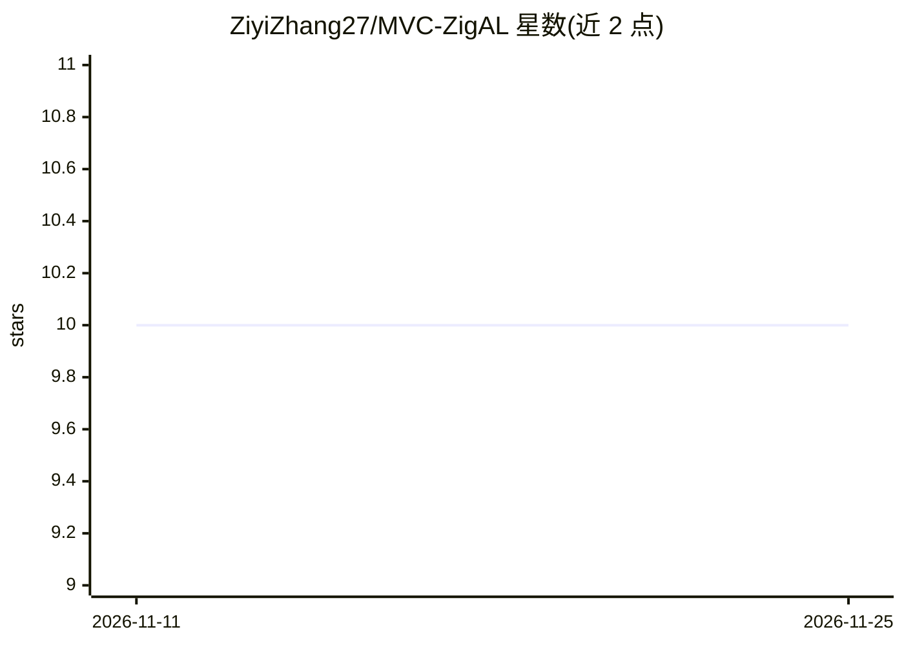

# ZiyiZhang27/MVC-ZigAL

⭐ 10 · Python · 推送 2026-02-25 · [GitHub](https://github.com/ZiyiZhang27/MVC-ZigAL) · 组织维护

**少步文本到多视角扩散模型的 RL 微调研究代码（CVPR 2026）**

论文 MVC-ZigAL 的 PyTorch 实现，针对少步（few-step）文本到多视角扩散模型提出强化学习微调框架：联合建模多个生成视角的 MDP 与 joint-view reward、基于自精炼采样的 advantage learning、以及带拉格朗日对偶的多视角约束优化。提供 conda 环境安装、accelerate 多卡训练脚本与训练后 LoRA checkpoint 的推理脚本（默认 8 步生成）。训练依赖需另行下载的 MATE-3D 奖励模型 checkpoint，论文已被 CVPR 2026 接收。

## 筛选速览

| 维度 | 判定 | 备注 |
|---|---|---|
| AI 角色 | `ai-native` | 本体是模型或模型工具 |
| 许可风险 | `none` | — |
| 部署形态 | `None` |  |
| 模型依赖 | — | README 未给出锁定关系 |
| 硬件要求 | — | 无带数字的原话,不猜 |
| 安装摩擦 | `medium` | 含编译或系统依赖之一 |
| 成熟度 | — | 结构信号不足 |

## 能力要点

- 联合视角奖励的 MDP 建模与自精炼采样 advantage learning
- 提供 accelerate 多 GPU 训练脚本与预配置超参（4×24GB）
- 提供已训练 LoRA checkpoint 的文本生成多视角图像推理脚本
- 训练日志接入 Weights & Biases

## 适用场景

- 复现论文的少步 T2MV 扩散模型 RL 微调实验
- 基于文本提示生成多视角一致的图像
- 在此基础上研究多视角扩散的对齐与奖励设计

## 场景标签

`图像生成` `微调` `强化学习` · 领域:内容生成

## 证据(README 行号)

> L3: This repository contains a PyTorch implementation of **MVC-ZigAL**, as presented in our paper *Refining Few-Step Tex
> L11: > Text-to-multiview (T2MV) diffusion models have shown great promise in generating multiple views of a scene from a

## 星数曲线

2026-11-11 10 → 2026-11-25 10（+0）

---
*卡片 v1 · prompt 1.4 · 生成 2026-11-20 · 置信度 high · 依据 README sha `42e0840386b1` · [字段定义](../../DATASET.md)*
