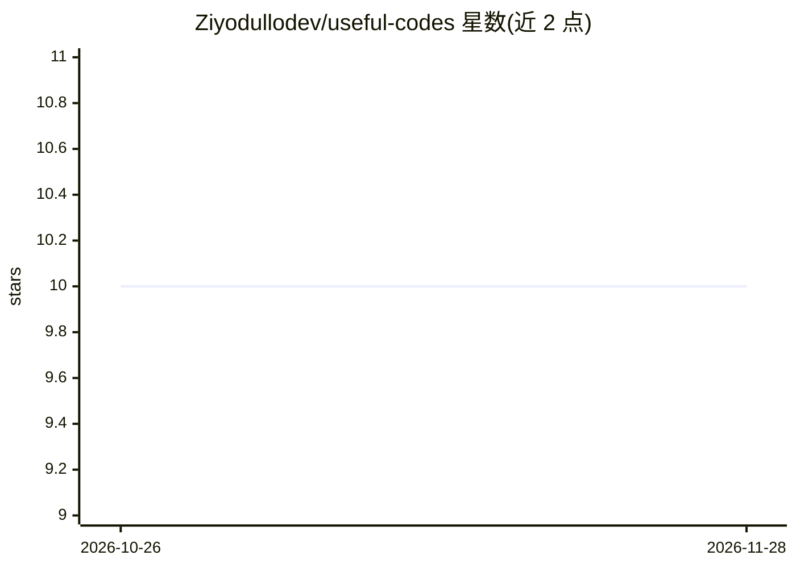

# Ziyodullodev/useful-codes

⭐ 10 · PHP · 推送 2026-03-15 · [GitHub](https://github.com/Ziyodullodev/useful-codes) · [官网](https://ziyodev.uz) · 个人维护

**PHP/Python 实用脚本集合：TTS、ChatGPT、绘图、翻译等**

收录多个 PHP 与 Python 脚本的功能集合仓库，涵盖英文文本转语音、ChatGPT 对话、Stability AI 图像生成、基于 Google Translate 的多语言翻译、天气 API 调用及 Telegram 个人介绍机器人。以脚本片段形式提供，适合直接复制使用，README 未提供安装与运行说明。

## 筛选速览

| 维度 | 判定 | 备注 |
|---|---|---|
| AI 角色 | `ai-knowledge` | 知识聚合/清单类 |
| 许可风险 | `none` | — |
| 部署形态 | `None` |  |
| 模型依赖 | — | README 未给出锁定关系 |
| 硬件要求 | — | 无带数字的原话,不猜 |
| 安装摩擦 | `low` | 无编译、无系统依赖或容器化 |
| 成熟度 | — | 结构信号不足 |

## 能力要点

- 英文文本转语音脚本
- ChatGPT 对话与 Stability AI 图像生成脚本
- Google Translate 多语言翻译（PHP/Python）
- Telegram 个人介绍机器人脚本

## 适用场景

- 需要现成代码片段调用 TTS/翻译/天气 API
- 搭建简单的 Telegram 介绍机器人
- 参考 AI API 的 PHP/Python 调用写法

## 场景标签

`图像生成` `语音合成` · 领域:内容生成

## 证据(README 行号)

> L6: - text-to-speach (english)
> L9: - other-useful-codes ( various useful script codes ( php, python ) )
> L10: - translate ( php and python script codes to translate from different languages to any language | with google trans

## 星数曲线

2026-10-26 10 → 2026-11-28 10（+0）

---
*卡片 v1 · prompt 1.4 · 生成 2026-11-20 · 置信度 mid · 依据 README sha `eb5d461da898` · [字段定义](../../DATASET.md)*
