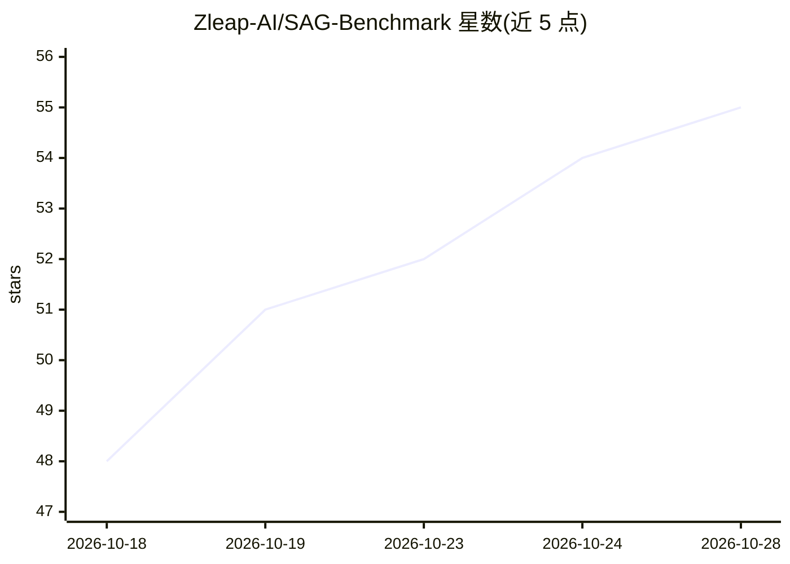

# Zleap-AI/SAG-Benchmark

⭐ 55 · Python · MIT · 推送 2026-10-19 · [GitHub](https://github.com/Zleap-AI/SAG-Benchmark) · [官网](https://arxiv.org/abs/2610.22588) · 组织维护 · 中文 README

**SAG2 论文官方基准复现代码：免嵌入多跳证据检索评测**

SAG2 论文的配套基准复现仓库。SAG2 用 SQLite FTS5 建索引、BM25 取候选、JEV API 打分并做多轮词项扩展，实现无需嵌入模型的多跳证据检索；索引阶段不做模型调用。仓库提供 MuSiQue、2WikiMultiHopQA、HotpotQA（各 1,000 题）与 EnterpriseRAG-Bench（511,962 文档）的评测脚本，以及 Agentic 与本地重排扩展。运行需 Python 3.11+、uv、C 编译器（首用编译 SQLite 评分扩展），查询阶段调用 OpenRouter 的 Jev API，检索本身不需要 GPU。

## 筛选速览

| 维度 | 判定 | 备注 |
|---|---|---|
| AI 角色 | `ai-ecosystem` | LLM/agent 周边工具 |
| 许可风险 | `permissive` | MIT |
| 部署形态 | `None` |  |
| 模型依赖 | — | README 未给出锁定关系 |
| 硬件要求 | — | 无带数字的原话,不猜 |
| 安装摩擦 | `medium` | 含编译或系统依赖之一 |
| 成熟度 | — | 结构信号不足 |

## 能力要点

- SQLite FTS5 + BM25 + JEV 打分的多轮词项扩展检索，索引阶段无模型调用
- 三个多跳问答数据集各 1,000 题的完整评测流程，报告 R@k / AE@k 证据召回
- EnterpriseRAG-Bench（511,962 文档）独立入口与只读索引评测
- 支持中断续跑与离线论文记录核验脚本

## 适用场景

- 复现 SAG2 论文报告的基准得分
- 在多跳问答数据集上评测证据检索召回率
- 在企业规模语料上运行文档检索评测

## 场景标签

`模型评测` `语义搜索` · 领域:评测与运维

## 证据(README 行号)

> L12:  The companion benchmark repository for the SAG2 paper. SQLite FTS5, BM25 and JEV connect source evidence at query 
> L31: ## Benchmark Score Reproduction

## 星数曲线

2026-10-18 48 → 2026-10-28 55（+7）

---
*卡片 v1 · prompt 1.4 · 生成 2026-10-24 · 置信度 high · 依据 README sha `f5c5a1004ebb` · [字段定义](../../DATASET.md)*
