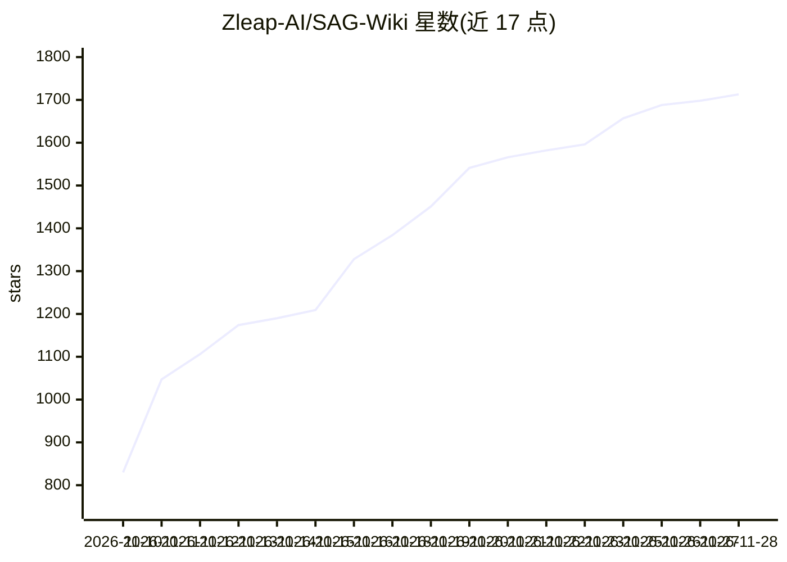

# Zleap-AI/SAG-Wiki

⭐ 1,713 · Rust · MIT · 推送 2026-11-27 · [GitHub](https://github.com/Zleap-AI/SAG-Wiki) · [官网](https://sag-wiki.zleap.com) · 组织维护 · 中文 README

**面向人与 agent 的本地文件知识库：快速索引、可溯源检索问答**

基于 Rust + Tauri + Svelte 的桌面与 CLI 知识库：将本地文件夹中的文档、笔记与代码建立索引，检索与建索不调用 LLM，核心为自研 SAG2 证据检索方法（Jev 证据评分与查询时扩展）。支持 PDF/Office/EPUB 开箱转换，OCR 与音视频转写为可选组件；问答需配置决策模型与回答模型的 API key，回答附原文出处引用。桌面支持 macOS/Windows，CLI 提供 npm 包并支持 Linux 浏览器模式，官方 Skill 供 Claude Code/Codex/OpenCode 接入。

## 筛选速览

| 维度 | 判定 | 备注 |
|---|---|---|
| AI 角色 | `ai-native` | 本体是模型或模型工具 |
| 许可风险 | `permissive` | MIT |
| 部署形态 | `library` | 以包/库形式分发 |
| 模型依赖 | — | README 未给出锁定关系 |
| 硬件要求 | — | 无带数字的原话,不猜 |
| 安装摩擦 | `low` | 无编译、无系统依赖或容器化 |
| 成熟度 | — | 结构信号不足 |

## 能力要点

- SAG2 检索：无嵌入、无 LLM 调用建索引，百万字符约 200ms
- 回答附引用，可定位并高亮原文段落
- 提供 SKILL.md，供 Claude Code/Codex/OpenCode 等直接安装使用
- CLI 与桌面共享设置与知识库，CLI 可独立运行

## 适用场景

- 把本地文档和笔记变成可搜索、可问答的知识库
- 给编码 agent 提供项目内知识检索能力
- 在 Linux 服务器上以浏览器方式访问知识库
- 对混合或扫描版 PDF 做后台 OCR 与表格增强后检索

## 场景标签

`知识库管理` `RAG` `文档问答` · 领域:知识与检索

## 证据(README 行号)

> L16:  A lightweight knowledge base for people and agents. Index and search your local files without LLM calls, then ask 
> L64: SAG-Wiki runs on **SAG2, our original retrieval method**. It builds a local index without embeddings or LLM calls, 
> L126: SAG supports **Claude Code, Codex, and OpenCode**. The Skill includes CLI installation, configuration, project ind

## 星数曲线

2026-11-10 830 → 2026-11-28 1,713（+883）

---
*卡片 v1 · prompt 1.4 · 生成 2026-11-23 · 置信度 high · 依据 README sha `1332a2d48ad0` · [字段定义](../../DATASET.md)*
