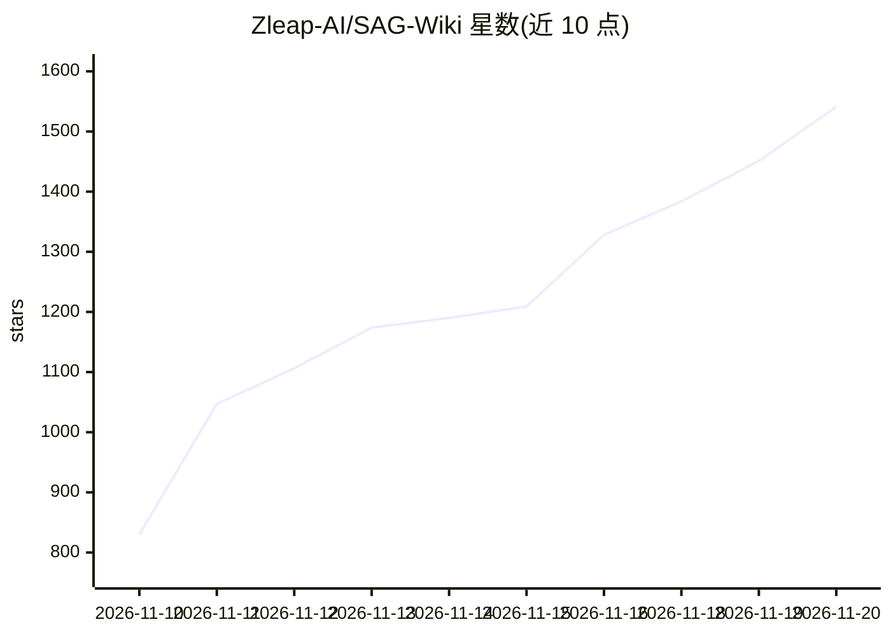

# Zleap-AI/SAG-Wiki

⭐ 1,541 · Rust · MIT · 推送 2026-11-19 · [GitHub](https://github.com/Zleap-AI/SAG-Wiki) · [官网](https://sag-wiki.zleap.com) · 组织维护 · 中文 README

**本地知识库桌面应用：为人和 agent 提供快速索引与可溯源检索**

面向个人用户与编程 agent 的轻量知识库：将本地文件夹（PDF/Office/EPUB/Markdown 等）建立索引，索引与检索默认不调用 LLM、不使用嵌入，基于自研 SAG2 方法做跨文档证据检索；配置模型后可在 Chat 中提问并获得可点击溯源到原文段落的引用回答。提供 macOS/Windows 桌面版与 npm 安装的 CLI，CLI 附带 SKILL.md 供 Claude Code、Codex、OpenCode 安装为技能。深入语义检索与 Q&A 需自行配置决策/回答模型及 API key，OCR、图像识别与音视频转写为按需下载的可选组件。

## 筛选速览

| 维度 | 判定 | 备注 |
|---|---|---|
| AI 角色 | `ai-native` | 本体是模型或模型工具 |
| 许可风险 | `permissive` | MIT |
| 部署形态 | `library` | 以包/库形式分发 |
| 模型依赖 | — | README 未给出锁定关系 |
| 硬件要求 | — | 无带数字的原话,不猜 |
| 安装摩擦 | `low` | 无编译、无系统依赖或容器化 |
| 成熟度 | — | 结构信号不足 |

## 能力要点

- 索引与检索不调用 LLM、不使用嵌入，百万字符文本索引约 200ms
- SAG2 证据检索，回答引用可点击溯源到原文段落
- CLI 与桌面版共享同一本地服务和知识库，可安装为 Claude Code/Codex/OpenCode 技能
- PDF/Office/EPUB 开箱即用转换，OCR 与表格增强后台进行

## 适用场景

- 把本地文档、笔记和代码文件夹变成可搜索、可溯源的知识库
- 让编程 agent 通过 CLI Skill 访问同一知识库查找代码依据
- 对文件提问并获得带原文引用的答案

## 场景标签

`知识库管理` `文档问答` · 领域:知识与检索

## 证据(README 行号)

> L16:  A lightweight knowledge base for people and agents. Index and search your local files without LLM calls, then ask 
> L64: SAG-Wiki runs on **SAG2, our original retrieval method**. It builds a local index without embeddings or LLM calls, 

## 星数曲线

2026-11-10 830 → 2026-11-20 1,541（+711）

---
*卡片 v1 · prompt 1.4 · 生成 2026-11-17 · 置信度 high · 依据 README sha `a1b3cd5bac4b` · [字段定义](../../DATASET.md)*
