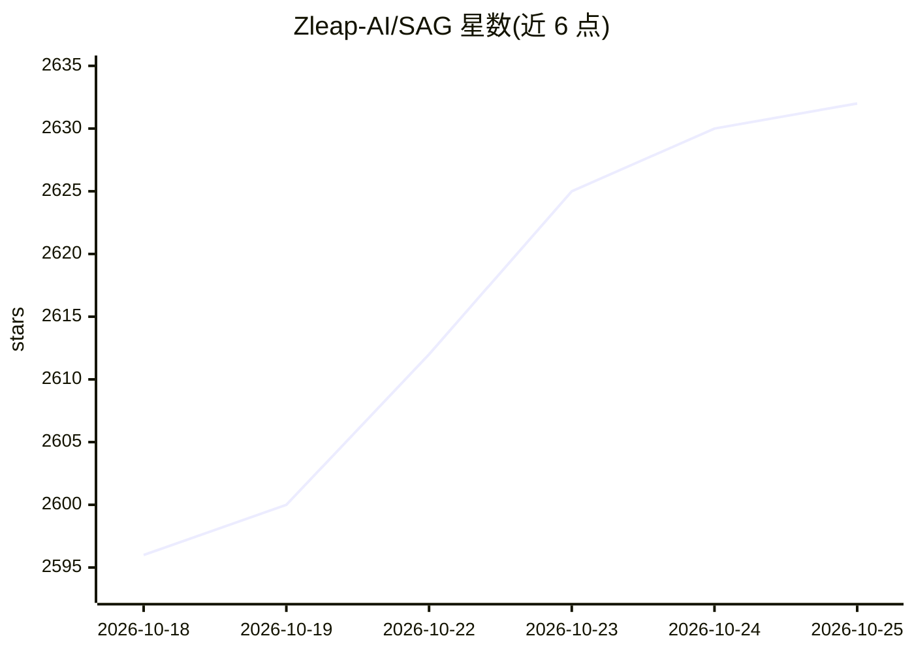

# Zleap-AI/SAG

⭐ 2,635 · Python · MIT · 推送 2026-10-24 · [GitHub](https://github.com/Zleap-AI/SAG) · [官网](https://zleap.com) · 组织维护 · 中文 README

**面向个人与 Agent 的本地优先知识库应用，含 SAG 检索架构**

基于 SAG 架构的知识库应用：上传文档后自动解析、分块、嵌入并抽取事件与实体，通过 SQL 查询时动态超边实现语义检索与关系推理，所有检索结果可回溯到原始分块。面向个人用户和 Agent，提供带引用的多轮对话、事件-实体图谱查看、REST/OpenAPI、OpenAI 兼容接口与 MCP 集成。默认使用 SQLite 与 LanceDB，无需外部数据库，定位本地优先、单用户。提供桌面安装包与 Docker 自托管两种部署方式；索引需配置嵌入模型，生成需配置 LLM（如 DeepSeek、302.AI）。

## 筛选速览

| 维度 | 判定 | 备注 |
|---|---|---|
| AI 角色 | `ai-native` | 本体是模型或模型工具 |
| 许可风险 | `permissive` | MIT |
| 部署形态 | `desktop` | 安装包/桌面程序 |
| 模型依赖 | locked-api |  |
| 硬件要求 | — | 无带数字的原话,不猜 |
| 安装摩擦 | `low` | 无编译、无系统依赖或容器化 |
| 成熟度 | — | 结构信号不足 |

## 能力要点

- 事件-实体索引与查询时动态超边检索，支持 Fast/Precise/JEV 重排模式
- 检索结果与引用可回溯到原始分块，答案带可点击引用
- 桌面安装包（macOS/Windows）内置全部运行时，无需安装 Python/Node/数据库
- 提供 REST/OpenAPI、OpenAI 兼容接口、MCP 与 zleap-sag Python 包

## 适用场景

- 把散落的文档整理成可搜索、可溯源的个人知识库
- 多跳问题上获得带引用的 grounded 回答
- 通过 MCP 或 API 把同一知识库暴露给其他应用或 Agent

## 场景标签

`知识库管理` `文档问答` `知识图谱` · 领域:知识与检索

## 证据(README 行号)

> L34: This project is a complete knowledge base application for individuals and Agents built on SAG:
> L38: Upload a document once. SAG parses it, splits it into chunks, embeds it, extracts events and entities, and keeps ev
> L46: |Agent chat|Multi-turn answers grounded in selected sources, with clickable citations|

## 星数曲线

2026-10-18 2,596 → 2026-10-25 2,632（+36）

---
*卡片 v1 · prompt 1.4 · 生成 2026-10-21 · 置信度 mid · 依据 README sha `61bb7a30fa79` · [字段定义](../../DATASET.md)*
