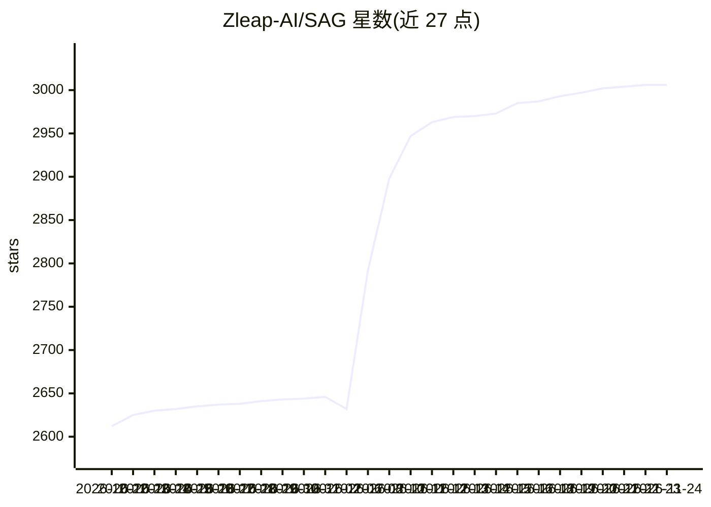

# Zleap-AI/SAG

⭐ 3,006 · Python · MIT · 推送 2026-11-13 · [GitHub](https://github.com/Zleap-AI/SAG) · [官网](https://zleap.com) · 组织维护 · 中文 README

**面向个人与 Agent 的本地知识库应用，提供事件-实体检索与溯源问答**

SAG 是基于自研检索架构（事件-实体索引+查询时动态超边）构建的知识库应用：上传文档后解析、分块、嵌入并抽取事件与实体，检索结果可回溯到原文块，支持带引用的多轮 Agent 对话，并通过 REST/OpenAPI、OpenAI 兼容接口、MCP 及 Python 包对外复用。默认本地优先、单用户，以 SQLite 与 LanceDB 启动，无需外部数据库，可切换 PostgreSQL/pgvector 等生产后端。提供 macOS/Windows 桌面安装包与 Docker 自托管两种运行方式。

## 筛选速览

| 维度 | 判定 | 备注 |
|---|---|---|
| AI 角色 | `ai-native` | 本体是模型或模型工具 |
| 许可风险 | `permissive` | MIT |
| 部署形态 | `desktop` | 安装包/桌面程序 |
| 模型依赖 | — | README 未给出锁定关系 |
| 硬件要求 | — | 无带数字的原话,不猜 |
| 安装摩擦 | `low` | 无编译、无系统依赖或容器化 |
| 成熟度 | — | 结构信号不足 |

## 能力要点

- 事件-实体索引与查询时动态超边的检索架构，语义检索与关系推理在同一系统内完成
- 检索结果与引用可回溯至原始文本块
- 集成方式含自托管 REST/OpenAPI、OpenAI 兼容聊天、MCP 与 zleap-sag Python 包
- 默认 SQLite+LanceDB 本地启动，无 API key、Python/Node 运行时或外部数据库即可启动

## 适用场景

- 上传文档后进行跨源检索并查看原文出处
- 基于选定来源发起带引用的多轮问答
- 通过 MCP 或 API 把本地知识库接入其他应用与 Agent

## 场景标签

`知识库管理` `RAG` `文档问答` `知识图谱` · 领域:知识与检索

## 证据(README 行号)

> L38: This project is a complete knowledge base application for individuals and Agents built on SAG:
> L50: |Agent chat|Multi-turn answers grounded in selected sources, with clickable citations|
> L53: The product is deliberately local-first and single-user. It starts with SQLite and LanceDB, requires no external da

## 星数曲线

2026-10-22 2,612 → 2026-11-24 3,006（+394）

---
*卡片 v1 · prompt 1.4 · 生成 2026-11-23 · 置信度 mid · 依据 README sha `a9c543cc225e` · [字段定义](../../DATASET.md)*
