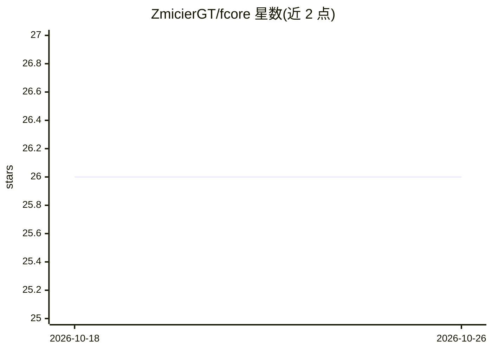

# ZmicierGT/fcore

⭐ 26 · Python · NOASSERTION · 推送 2026-10-25 · [GitHub](https://github.com/ZmicierGT/fcore) · 个人维护

**面向金融市场的分析框架：数据获取、AI 策略、回测与选股**

Python 金融分析框架，提供数据获取与数据库缓存（Yahoo Finance/FMP 封装、子查询合并多数据源、labelled numpy 数组容器）、Tools API（技术指标计算与机器学习任务自动化，含增量学习和超内存数据集训练）、Classification/Regression 两套 AI API、考虑佣金与多证券的回测引擎、选股 API 与报告生成。给需要在统一框架内实现并测试自有金融策略的开发者使用；不提供现成策略。项目自述处于开发阶段，API 可能变化，采用自定义 source-available 许可证分发。

## 筛选速览

| 维度 | 判定 | 备注 |
|---|---|---|
| AI 角色 | `ai-ecosystem` | LLM/agent 周边工具 |
| 许可风险 | `none` | NOASSERTION |
| 部署形态 | `library` | 以包/库形式分发 |
| 模型依赖 | — | README 未给出锁定关系 |
| 硬件要求 | — | 无带数字的原话,不猜 |
| 安装摩擦 | `low` | 无编译、无系统依赖或容器化 |
| 成熟度 | `idea` | |

## 能力要点

- Yahoo Finance/FMP 数据封装与 sqlite 缓存，子查询合并多源数据
- Classification/Regression AI API 可对市场事件分类并估计增长概率
- 计入佣金费用、支持多证券与组合管理的回测引擎
- 按最新报价按需选股的 screening API 与报告生成

## 适用场景

- 获取并统一存储多来源金融行情与基本面数据
- 用分类/回归模型判断交易信号真假并估计增长概率
- 对多证券策略回测并生成报告与组合管理演示

## 场景标签

`金融量化` · 领域:学习与行业

## 证据(README 行号)

> L6: - Use an API to ease the development of AI-strategies for financial markets analysis.
> L42: Fcore has a Tools API to ease a data processing routine work. A tools may just perform some basic calculations (lik
> L44: AI API is divided into two parts: The Classification API which allows to classify nearly every market event and The

## 星数曲线

2026-10-18 26 → 2026-10-26 26（+0）

---
*卡片 v1 · prompt 1.4 · 生成 2026-10-26 · 置信度 low · 依据 README sha `b1fb3ffdcc8b` · [字段定义](../../DATASET.md)*
