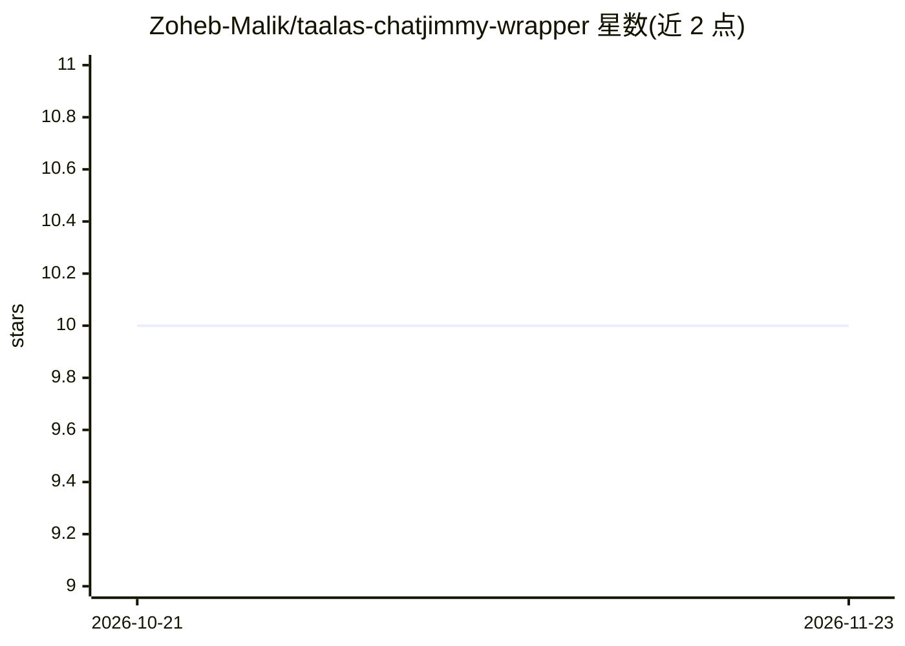

# Zoheb-Malik/taalas-chatjimmy-wrapper

⭐ 10 · TypeScript · MIT · 推送 2026-02-23 · [GitHub](https://github.com/Zoheb-Malik/taalas-chatjimmy-wrapper) · 个人维护

**面向开发者的 chatjimmy.ai OpenAI 兼容代理封装**

非官方的 Node.js/Fastify 代理服务，在 chatjimmy.ai（llama-3.1:8B）前提供 OpenAI 风格的 /v1/models 与 /v1/chat/completions 端点，使现有 OpenAI SDK/客户端无需改写调用即可接入；支持流式与非流式补全、请求校验、OpenAI 风格错误格式、可选 WRAPPER_API_KEY 鉴权及可配置的 payload/tool 限制。需 Node.js 20+ 与 pnpm，从源码安装运行；README 自述为社区项目，非 Taalas 官方，兼容性为 best-effort。

## 筛选速览

| 维度 | 判定 | 备注 |
|---|---|---|
| AI 角色 | `ai-ecosystem` | LLM/agent 周边工具 |
| 许可风险 | `permissive` | MIT |
| 部署形态 | `library` | 以包/库形式分发 |
| 模型依赖 | — | README 未给出锁定关系 |
| 硬件要求 | — | 无带数字的原话,不猜 |
| 安装摩擦 | `low` | 无编译、无系统依赖或容器化 |
| 成熟度 | — | 结构信号不足 |

## 能力要点

- 提供 OpenAI 风格的 /v1/models 与 /v1/chat/completions 端点
- 支持流式与非流式补全及 OpenAI 风格错误格式
- 可选 WRAPPER_API_KEY 鉴权与实验性 tool 字段开关
- 内置 curl/Node/Python 示例脚本与测试套件

## 适用场景

- 让已用 OpenAI SDK 的项目直接切换到 chatjimmy.ai 端点
- 在本地代理层统一校验请求并控制 tool 调用行为
- 通过自建代理为上游请求附加独立的 API key 鉴权

## 场景标签

`模型网关` · 领域:Agent 开发

## 证据(README 行号)

> L3: Lightweight OpenAI-compatible wrapper for `https://chatjimmy.ai` by Taalas (`llama3.1-8B`).
> L16: - OpenAI-style endpoints:
> L26: - Node.js 20+

## 星数曲线

2026-10-21 10 → 2026-11-23 10（+0）

---
*卡片 v1 · prompt 1.4 · 生成 2026-11-20 · 置信度 mid · 依据 README sha `d59327694479` · [字段定义](../../DATASET.md)*
