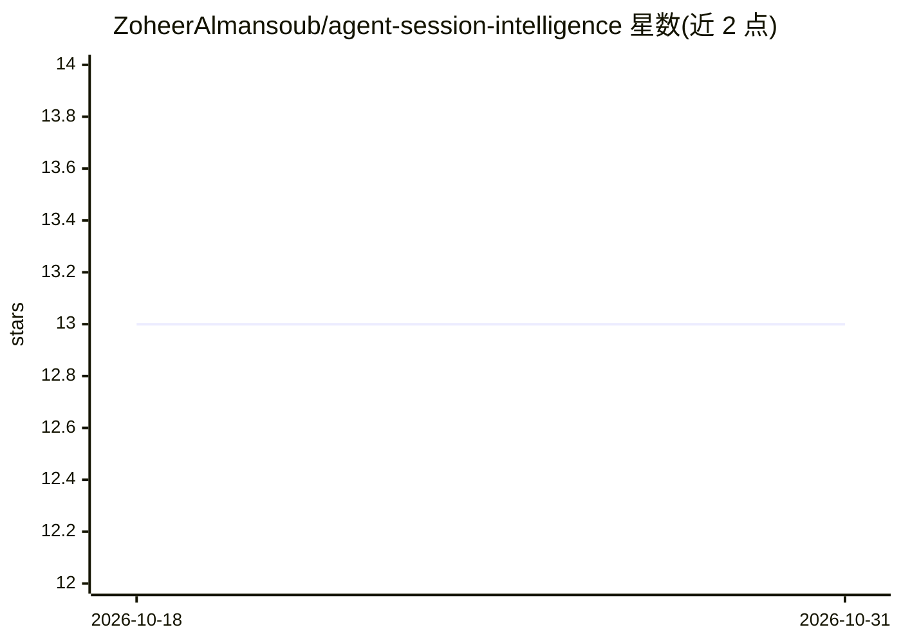

# ZoheerAlmansoub/agent-session-intelligence

⭐ 13 · TypeScript · GPL-3.0 · 推送 2026-08-11 · [GitHub](https://github.com/ZoheerAlmansoub/agent-session-intelligence) · [官网](https://github.com/ZoheerAlmansoub/agent-session-intelligence#readme) · 个人维护

**本地优先的 AI 编程会话可视化与分析工具**

本地运行的 Web 应用（Bun API + React/Vite UI），读取 Claude Code、Pi、Cursor、OpenCode、Antigravity 的会话转录文件，提供上下文 token 分布图表、消息浏览、19 种 LLM 分析、治理流水线及 skills/rules/hooks 等 artifact 生成。会话数据保留在本机，仅用户配置的 LLM API 调用会外发。支持 Anthropic、OpenAI、Ollama 等 8 个 LLM 提供商，通过 git clone 源码运行，无安装包。

## 筛选速览

| 维度 | 判定 | 备注 |
|---|---|---|
| AI 角色 | `ai-ecosystem` | LLM/agent 周边工具 |
| 许可风险 | `viral` | GPL-3.0 |
| 部署形态 | `None` |  |
| 模型依赖 | local-ok | 支持本地模型 |
| 硬件要求 | — | 无带数字的原话,不猜 |
| 安装摩擦 | `low` | 无编译、无系统依赖或容器化 |
| 成熟度 | — | 结构信号不足 |

## 能力要点

- 支持 5 种 agent 工具的会话转录读取（JSONL/SQLite）
- 19 种 LLM 分析类型与治理流水线（Quick/Standard/Full）
- 生成 skills、rules、hooks、sub-agent specs 等 artifact
- 会话数据本地留存，LLM 提供商在应用内或 .env 配置

## 适用场景

- 分析 Claude Code/Cursor 等会话的上下文 token 构成与浪费
- 诊断重试循环、工具错误等会话问题
- 从历史会话生成团队治理规则与 agent 技能

## 场景标签

`LLM 可观测性` · 领域:评测与运维

## 证据(README 行号)

> L6: Local-first web app to **visualize and analyze agent sessions** from Claude Code, Cursor, Pi, OpenCode, and Antigrav
> L57: 19 analysis types across six categories — token audit, loop diagnosis, compaction recovery, artifact blueprints, me
> L73: Anthropic · OpenAI · OpenRouter · OpenCode Zen · Groq · DeepSeek · Ollama · NVIDIA NIM

## 星数曲线

2026-10-18 13 → 2026-10-31 13（+0）

---
*卡片 v1 · prompt 1.4 · 生成 2026-10-31 · 置信度 high · 依据 README sha `f33a3d80958b` · [字段定义](../../DATASET.md)*
