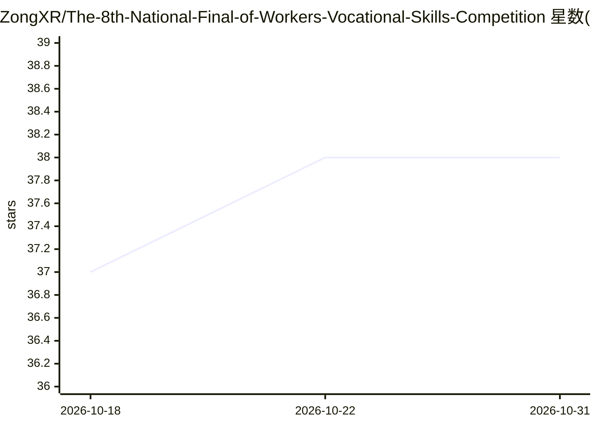

# ZongXR/The-8th-National-Final-of-Workers-Vocational-Skills-Competition

⭐ 38 · Jupyter Notebook · GPL-3.0 · 推送 2026-09-29 · [GitHub](https://github.com/ZongXR/The-8th-National-Final-of-Workers-Vocational-Skills-Competition) · [官网](https://ldjj.acftu.org/wjytzgg/202406/P020240604573052992218.pdf) · 个人维护 · 中文 README

**第八届全国职工职业技能大赛人工智能训练师赛项技术文件**

本仓库收录第八届全国职工职业技能大赛人工智能训练师赛项的技术描述文档，面向全国相关专业的职业从业人员。内容涵盖竞赛的知识与能力权重（基础理论、数据处理、机器学习、深度学习、生成式模型、应用开发）、试题形式（90 分钟 270 道理论题）与 480 分钟实操三模块：数据分析与挖掘、大语言模型特定任务微调（如 Gemma-2B 配 LoRA 等高效微调）、智能自动驾驶场景综合应用（数据采集标注、YOLO 目标检测、模型部署），并附评分标准、评判流程与保密安排。

## 筛选速览

| 维度 | 判定 | 备注 |
|---|---|---|
| AI 角色 | `ai-knowledge` | 知识聚合/清单类 |
| 许可风险 | `viral` | GPL-3.0 |
| 部署形态 | `None` |  |
| 模型依赖 | — | README 未给出锁定关系 |
| 硬件要求 | — | 无带数字的原话,不猜 |
| 安装摩擦 | `low` | 无编译、无系统依赖或容器化 |
| 成熟度 | — | 结构信号不足 |

## 能力要点

- 实操 480 分钟三模块：数据分析挖掘 / LLM 微调 / 智能自动驾驶综合应用
- 模块 B 提供大语言模型（如 Gemma-2B）与 3 种下游任务数据集，考查参数高效微调
- 理论部分 270 道题 150 分，实操 350 分，总成绩 500 分制
- 附评分细则、违规扣分规则与成绩排序、保密安排

## 适用场景

- 备赛选手了解人工智能训练师赛项的考核范围与评分标准
- 职业院校按国家职业技能标准设计人工智能训练课程参考
- 研究者查阅国内职业技能竞赛的命题结构

## 场景标签

`教程课程` · 领域:学习与行业

## 证据(README 行号)

> L1: 第八届全国职业职工技能大赛人工智能训练师赛项
> L153:  本赛项专家组根据本竞赛技术规则要求组织命题。大赛全国组委会技术委员会组织有关专家参照现行《人工智能训练师国家职业技能标准》（三级）应知应会的知识与技能、结合企业生产、院校教学实际和人工智能训练的发展状况，并借鉴世界技能大赛相关
> L188:  考试内容说明:本次比赛的主办方将向参赛者提供一个大语言模型(如Gemma-2B 或其它相似大小的模型)以及 3 种下游任务数据集（如MRPC或RTE）。参赛者需要利用高效参数微调技术,在下游任务数据集上分别对大模型进行微调，使

## 星数曲线

2026-10-18 37 → 2026-10-31 38（+1）

---
*卡片 v1 · prompt 1.4 · 生成 2026-10-25 · 置信度 high · 依据 README sha `3bc107276a30` · [字段定义](../../DATASET.md)*
