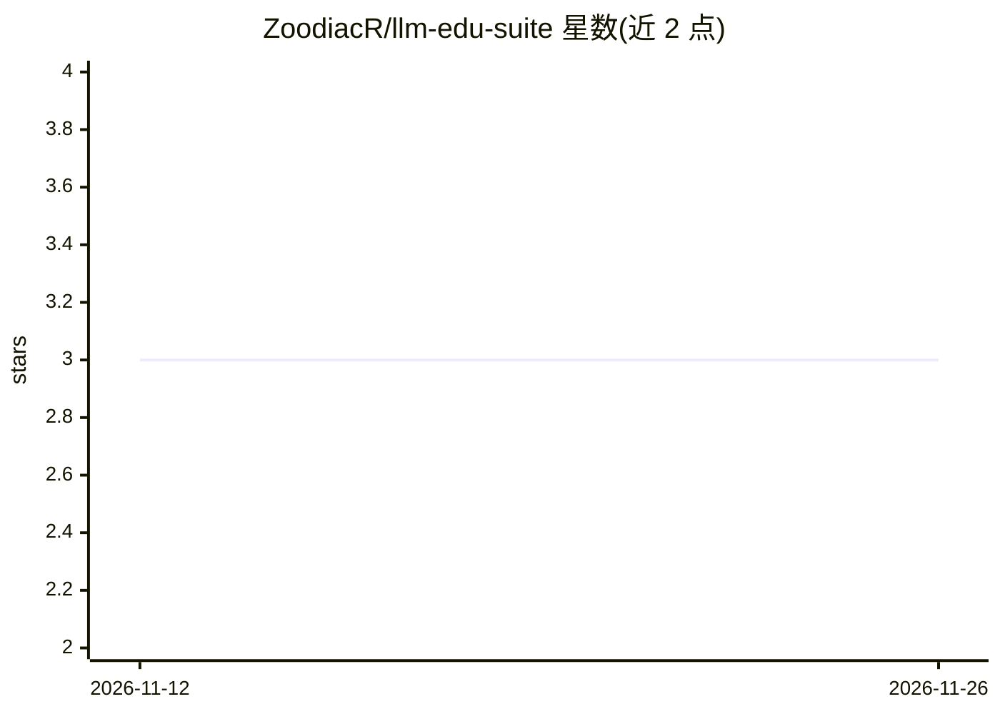

# ZoodiacR/llm-edu-suite

⭐ 3 · Jupyter Notebook · MIT · 推送 2026-11-12 · [GitHub](https://github.com/ZoodiacR/llm-edu-suite) · 个人维护

**面向学习者的 LLM 工程双语教程：32 个笔记本逐层构建与测量**

由 32 个已执行笔记本组成的 LLM 工程教程，分两半：前半用 PyTorch 从零实现语言模型（分词、注意力、预训练、量化、推理），后半用 Hugging Face、LangChain、LangGraph、LangSmith、RAGAS 与 MCP 教应用层（SFT/LoRA/DPO/GRPO、RAG、agent、LLMOps）。每个笔记本带评估环节，笔记本在普通笔记本电脑上以 Ollama 本地模型运行，无需 API key；提供英文与西班牙文文档，v2 版将手写实现限定在模型内部部分。

## 筛选速览

| 维度 | 判定 | 备注 |
|---|---|---|
| AI 角色 | `ai-knowledge` | 知识聚合/清单类 |
| 许可风险 | `permissive` | MIT |
| 部署形态 | `None` |  |
| 模型依赖 | local-ok | 支持本地模型 |
| 硬件要求 | — | 无带数字的原话,不猜 |
| 安装摩擦 | `medium` | 含编译或系统依赖之一 |
| 成熟度 | — | 结构信号不足 |

## 能力要点

- 32 个笔记本全部带输出、图表与评估环节，CI 中用 fake LLM 跑快速测试
- 本地可运行：Ollama（qwen2.5:3b、nomic-embed-text）与 SmolLM2，CPU 亦可，无需 API key
- 覆盖从 BPE/RoPE 到 GRPO、量化、RAG、agent harness 与 MCP 的全栈主题
- 笔记本展示技术在何种设置下无效并解释原因

## 适用场景

- 想从零理解 transformer 与预训练/后训练全流程的学习路径
- 学习用 LangChain/LangGraph/RAGAS 构建、评估 LLM 应用
- 在无 GPU 的笔记本上通过 Ollama 本地模型完成全部练习
- 了解量化、serving、可观测性等 LLMOps 实践的量化对比

## 场景标签

`教程课程` · 领域:学习与行业

## 证据(README 行号)

> L3: **Learn LLM engineering in two halves: build a language model from scratch in PyTorch to understand how it works, th
> L9: - **32 notebooks** grouped by topic, all executed with their outputs, plots and an evaluation section
> L10: - **Runs on your own laptop**: local models through Ollama (`qwen2.5:3b`, `nomic-embed-text`) and Hugging Face Smol

## 星数曲线

2026-11-12 3 → 2026-11-26 3（+0）

---
*卡片 v1 · prompt 1.4 · 生成 2026-11-22 · 置信度 high · 依据 README sha `c48e91bd9b37` · [字段定义](../../DATASET.md)*
