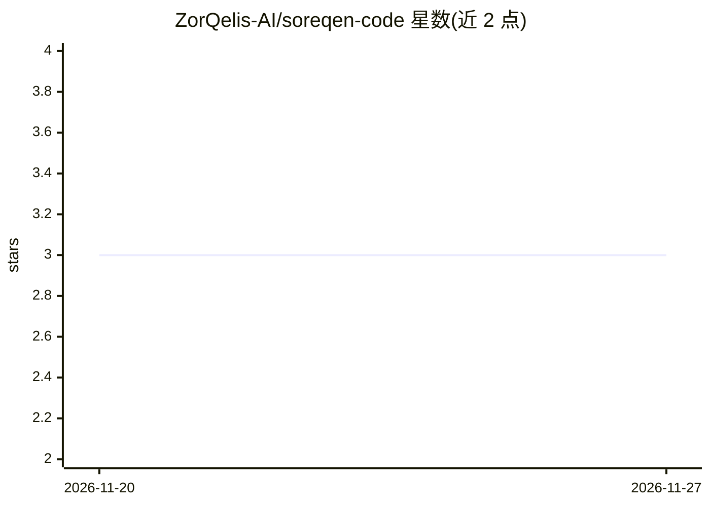

# ZorQelis-AI/soreqen-code

⭐ 3 · TypeScript · Apache-2.0 · 推送 2026-11-19 · [GitHub](https://github.com/ZorQelis-AI/soreqen-code) · [官网](https://code.soreqen.com) · 组织维护

**终端里的自主编码 agent：规划、改码、跑测试并自检汇报**

面向开发者的 CLI 编码 agent：读取项目、规划任务、编辑文件、运行命令与测试，并对自身改动做检查后汇报已验证与未验证的内容。模型接入提供三类途径：SoreQen 账号登录使用托管 Flow 模型（含月度积分与限额机制）、Flex 余额按原价调用其他模型、或配置自己的 API key/providers.json。内置 24 个技能（12 常驻+12 条件加载），支持自定义技能、MCP 服务器接入、检查点回滚与跨会话记忆。需 Node.js 20+，npm 安装，另有桌面版。

## 筛选速览

| 维度 | 判定 | 备注 |
|---|---|---|
| AI 角色 | `ai-native` | 本体是模型或模型工具 |
| 许可风险 | `permissive` | Apache-2.0 |
| 部署形态 | `library` | 以包/库形式分发 |
| 模型依赖 | local-ok | 支持本地模型 |
| 硬件要求 | — | 无带数字的原话,不猜 |
| 安装摩擦 | `low` | 无编译、无系统依赖或容器化 |
| 成熟度 | — | 结构信号不足 |

## 能力要点

- 自主循环：规划、编辑、运行测试、自检并报告已验证内容
- 24 个内置技能（12 常驻工程内核+12 条件加载），支持自定义 SKILL.md
- 支持 MCP 服务器：工具、资源、prompts、采样，均带信任与确认机制
- Auto 模式先建检查点，支持 /rewind 回滚一轮改动

## 适用场景

- 让 agent 修复失败测试并验证修复结果
- 用 /goal 让 agent 多轮持续推进直到目标达成并验证
- 通过 MCP 服务器为 agent 扩展 GitHub 等外部工具
- 在终端中以非交互模式（--print）批量执行编码任务

## 场景标签

`编码 Agent` `Agent 框架` · 领域:Agent 开发

## 证据(README 行号)

> L3:  An autonomous coding agent for your terminal.
> L4:  It reads your project, plans, edits files, runs commands and tests, checks its own work, and reports what it actual
> L55: - **Use your own API key**: OpenAI, Anthropic, OpenRouter, DeepSeek or OpenCode. Keys are kept in

## 星数曲线

2026-11-20 3 → 2026-11-27 3（+0）

---
*卡片 v1 · prompt 1.4 · 生成 2026-11-22 · 置信度 high · 依据 README sha `7dce0d331842` · [字段定义](../../DATASET.md)*
