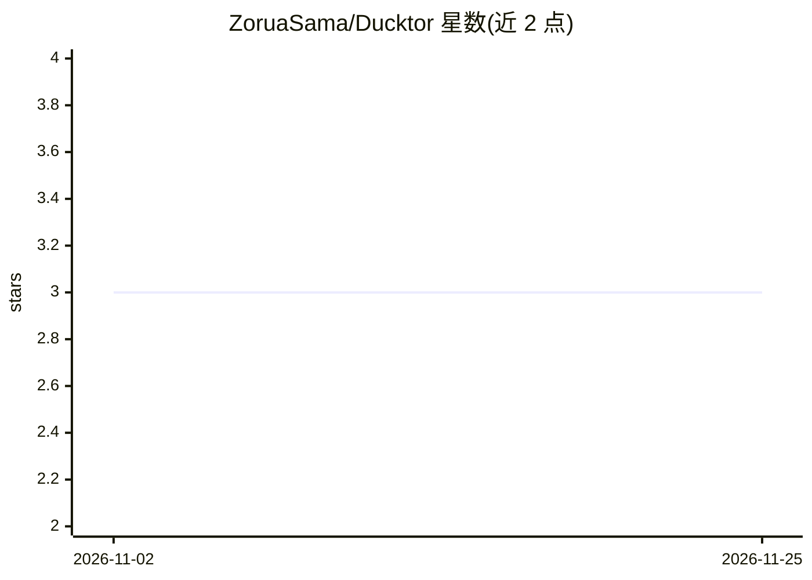

# ZoruaSama/Ducktor

⭐ 3 · JavaScript · 推送 2026-11-03 · [GitHub](https://github.com/ZoruaSama/Ducktor) · [官网](https://zoruasama.github.io/Ducktor/) · 个人维护 · 中文 README

**用 AI 生成代码解释并辅以 VS Code 阅读的扩展与技能**

由两部分组成：一个指导 AI agent 读取源码并生成 .ducktor 解释文件的生成器技能（SKILL.md），以及一个读取这些文件并在 VS Code 中展示块级解释、术语定义与逐行预览的扩展。解释按 L1–L5 深度分层生成，存储于与源码路径镜像的 YAML 文件中，不改动源码；扩展本身不含 AI，也不需要模型或 API key 配置，可脱离技能单独使用手写的解释文件。未发布到扩展市场，需从 GitHub Releases 下载 VSIX 安装。

## 筛选速览

| 维度 | 判定 | 备注 |
|---|---|---|
| AI 角色 | `ai-native` | 本体是模型或模型工具 |
| 许可风险 | `none` | — |
| 部署形态 | `library` | 以包/库形式分发 |
| 模型依赖 | — | README 未给出锁定关系 |
| 硬件要求 | — | 无带数字的原话,不猜 |
| 安装摩擦 | `low` | 无编译、无系统依赖或容器化 |
| 成熟度 | — | 结构信号不足 |

## 能力要点

- L1–L5 分层解释生成策略，可加 G（review 关注点）自由组合
- .ducktor YAML 文件镜像源码路径，锚点定位支持代码整体移动
- 悬停块级解释、术语定义、逐行双栏预览与 Mermaid 图导航
- 扩展与生成器技能解耦，扩展无需模型或 API key 配置

## 适用场景

- 接手陌生项目时让 agent 生成各层级代码解释辅助阅读
- 代码评审前为改动涉及的函数生成逐行解释与关注点
- 为教学或上手场景准备带术语定义的源码导读材料

## 场景标签

`代码审查` · 领域:编码与开发

## 证据(README 行号)

> L13: Ducktor stores code explanations in separate `.ducktor` files and displays them alongside source code in VS Code. I
> L24: The extension is not an AI generator and does not require model or API-key configuration. Generation is handled by 
> L22: Workflow: **source code → AI + generator skill → `.ducktor` files → VS Code extension → reading and navigation**.

## 星数曲线

2026-11-02 3 → 2026-11-25 3（+0）

---
*卡片 v1 · prompt 1.4 · 生成 2026-11-22 · 置信度 high · 依据 README sha `3a40fb8b783c` · [字段定义](../../DATASET.md)*
