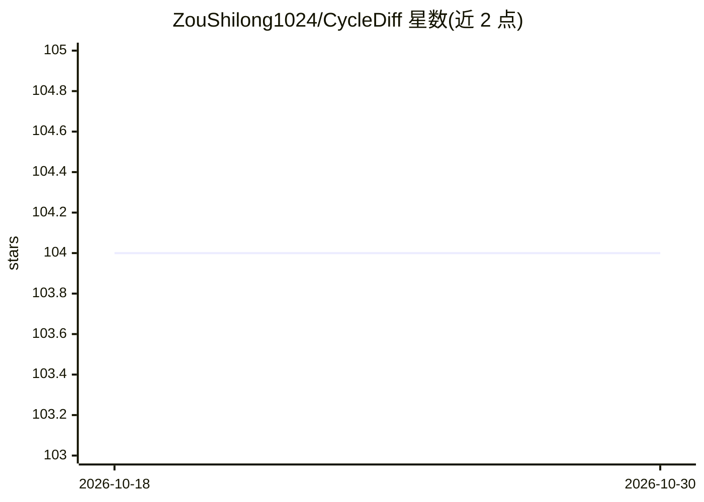

# ZouShilong1024/CycleDiff

⭐ 104 · Python · MIT · 推送 2026-03-29 · [GitHub](https://github.com/ZouShilong1024/CycleDiff) · [官网](https://zoushilong1024.github.io/CycleDiff/) · 组织维护 · 中文 README

**基于循环扩散模型的非配对图像翻译研究代码（TIP2026 论文）**

论文 CycleDiff 的官方代码实现：用循环扩散模型完成非配对图像到图像翻译，训练流程分三步（VAE、无条件 LDM、循环翻译器），通过 accelerate 启动，支持单卡与多卡训练，配置以 YAML 文件管理，需自行下载预训练权重并修改路径。测试阶段用训练好的配置直接运行翻译脚本。面向复现论文或开展跨模态医学图像翻译研究的开发者，依赖 PyTorch 1.13.1+cu117 与 Python 3.9 环境。

## 筛选速览

| 维度 | 判定 | 备注 |
|---|---|---|
| AI 角色 | `ai-native` | 本体是模型或模型工具 |
| 许可风险 | `permissive` | MIT |
| 部署形态 | `library` | 以包/库形式分发 |
| 模型依赖 | — | README 未给出锁定关系 |
| 硬件要求 | — | 无带数字的原话,不猜 |
| 安装摩擦 | `medium` | 含编译或系统依赖之一 |
| 成熟度 | — | 结构信号不足 |

## 能力要点

- 循环扩散模型实现非配对图像到图像翻译
- 三阶段训练流程：VAE → 无条件 LDM → 循环翻译器
- 循环翻译器支持多 GPU 训练
- 提供 accelerate 启动的训练与测试脚本及 YAML 配置

## 适用场景

- 复现论文的非配对图像翻译实验
- 在自有数据集上训练跨模态图像翻译模型
- 研究扩散模型替代 CycleGAN 的翻译方案

## 场景标签

`图像生成` `模型训练` · 领域:内容生成

## 证据(README 行号)

> L1: # 🌟 CycleDiff: CycleDiff: Cycle Diffusion Models for Unpaired Image-to-image Translation [arxiv paper	arxiv paper]
> L60:  title={CycleDiff: Cycle Diffusion Models for Unpaired Image-to-image Translation},

## 星数曲线

2026-10-18 104 → 2026-10-30 104（+0）

---
*卡片 v1 · prompt 1.4 · 生成 2026-10-23 · 置信度 high · 依据 README sha `66c1040c0fcf` · [字段定义](../../DATASET.md)*
