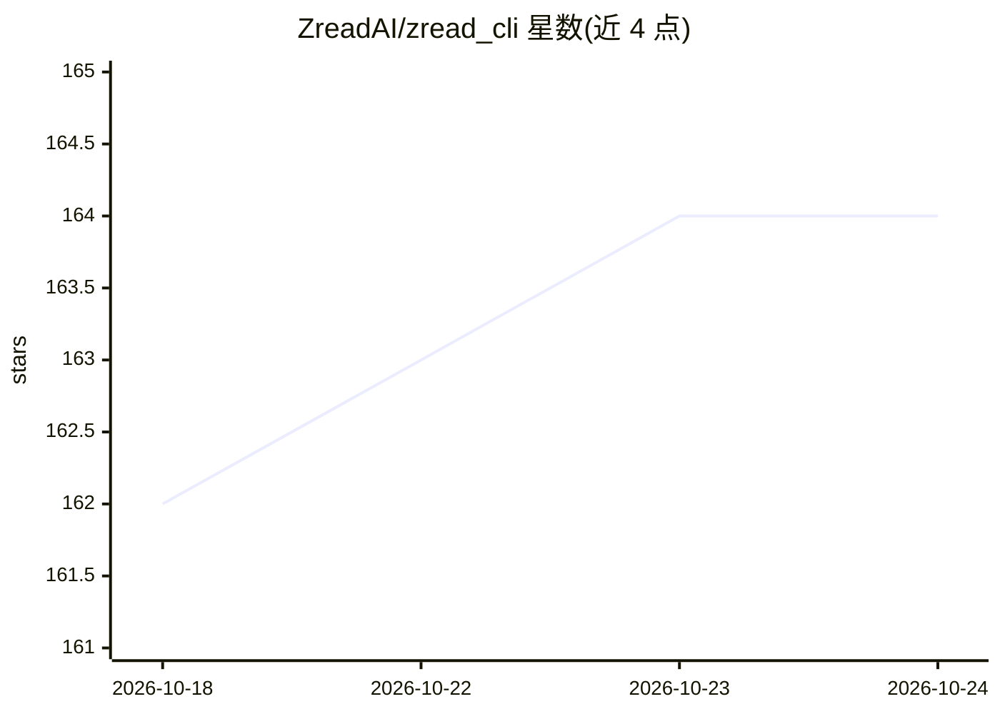

# ZreadAI/zread_cli

⭐ 164 · 推送 2026-05-27 · [GitHub](https://github.com/ZreadAI/zread_cli) · [官网](https://zread.ai/cli) · 组织维护 · 中文 README

**用 AI 把本地代码仓库生成 Wiki 文档的 CLI 工具**

Zread CLI 通过 AI 大模型分析本地代码仓库，生成结构化 Wiki 文档，保存在项目目录 .zread/wiki/ 下，本地存储不上传云端，并提供浏览器阅读器与历史版本管理。安装途径含 Homebrew、npm、winget 及预编译二进制（覆盖 macOS/Linux/Windows 多架构）。支持智谱、Z.AI、OpenAI、MoonShot、MiniMax、OpenRouter 等内置提供商，也可填自定义 OpenAI 兼容 BaseURL；生成中断后可续写草稿。

## 筛选速览

| 维度 | 判定 | 备注 |
|---|---|---|
| AI 角色 | `ai-native` | 本体是模型或模型工具 |
| 许可风险 | `none` | — |
| 部署形态 | `library` | 以包/库形式分发 |
| 模型依赖 | — | README 未给出锁定关系 |
| 硬件要求 | — | 无带数字的原话,不猜 |
| 安装摩擦 | `low` | 无编译、无系统依赖或容器化 |
| 成熟度 | — | 结构信号不足 |

## 能力要点

- 一条命令分析代码仓库并生成结构化 Wiki 文档
- 文档本地存储于 .zread/wiki/，不上传云端
- 支持智谱/Z.AI/OpenAI/MoonShot/MiniMax/OpenRouter 及自定义 OpenAI 兼容 BaseURL
- 生成中断可续写，支持历史版本浏览

## 适用场景

- 为我的项目快速生成可查阅的代码文档
- 团队共享由 AI 生成的代码 Wiki 并在浏览器中阅读
- 接入自备 Key 的 LLM 提供商生成文档

## 场景标签

`AI 写作` · 领域:内容生成

## 证据(README 行号)

> L5: Zread 是一款命令行工具，通过 AI 大模型自动分析代码仓库，生成结构化的 Wiki 文档，并提供内置阅读器供团队随时查阅。
> L67: |`zread generate`|为当前项目生成文档|

## 星数曲线

2026-10-18 162 → 2026-10-24 164（+2）

---
*卡片 v1 · prompt 1.4 · 生成 2026-10-22 · 置信度 high · 依据 README sha `2a595395b400` · [字段定义](../../DATASET.md)*
