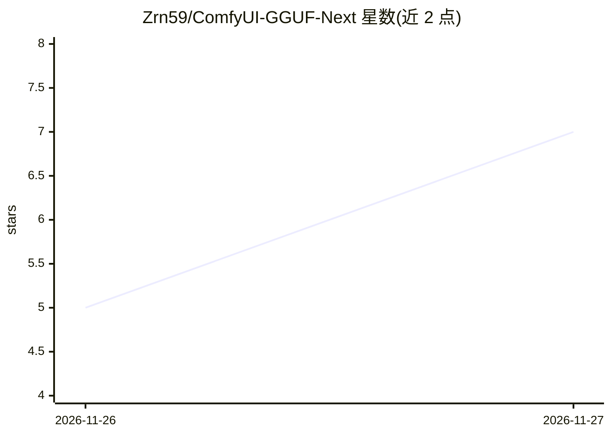

# Zrn59/ComfyUI-GGUF-Next

⭐ 7 · Python · Apache-2.0 · 推送 2026-11-25 · [GitHub](https://github.com/Zrn59/ComfyUI-GGUF-Next) · [官网](https://zrn59.me) · 个人维护

**为 ComfyUI 提供 GGUF 量化模型加载节点的扩展**

city96/ComfyUI-GGUF 的 fork，为 ComfyUI 提供 GGUF 加载节点：在 torch 中处理全部 35 种 ggml 存储类型（26 种量化）、更多扩散模型架构与文本编码器，节点 ID 与输入保持一致使既有工作流可直接打开。模型大于空闲内存时保持内存映射从文件读取，支持 compile_dequant 编译反量化内核。需已有可运行的 ComfyUI（Python 3.9+），安装前须移除或禁用原 ComfyUI-GGUF。

## 筛选速览

| 维度 | 判定 | 备注 |
|---|---|---|
| AI 角色 | `ai-ecosystem` | LLM/agent 周边工具 |
| 许可风险 | `permissive` | Apache-2.0 |
| 部署形态 | `desktop` | 安装包/桌面程序 |
| 模型依赖 | — | README 未给出锁定关系 |
| 硬件要求 | — | 无带数字的原话,不猜 |
| 安装摩擦 | `medium` | 含编译或系统依赖之一 |
| 成熟度 | — | 结构信号不足 |

## 能力要点

- 全部 35 种 ggml 存储类型在 torch 中于 GPU 上处理，与 gguf-py 逐位一致
- 支持 T5、Llama、Qwen3-VL、Gemma 4、Mistral 3 等多种 GGUF 文本编码器
- 大于空闲内存的模型保持内存映射，直接从文件读取
- 节点类别与 ID 与上游一致，既有工作流无需修改

## 适用场景

- 在低显存显卡上加载 GGUF 量化的扩散模型做图像/视频生成
- 为 ComfyUI 工作流加载 Qwen3-VL、Gemma 等量化文本编码器
- 替换 ComfyUI 中的原 GGUF 加载节点以读取更多量化类型

## 场景标签

`图像生成` `视频生成` `模型量化` · 领域:内容生成

## 证据(README 行号)

> L13: GGUF loader nodes for ComfyUI. This is a fork of city96/ComfyUI-GGUF with more quant types, more diffusion models a
> L60: You need a working ComfyUI with Python 3.9 or newer. Remove or disable the original ComfyUI-GGUF first: both packs 
> L64: git clone https://github.com/Zrn59/ComfyUI-GGUF-Next

## 星数曲线

2026-11-26 5 → 2026-11-27 7（+2）

---
*卡片 v1 · prompt 1.4 · 生成 2026-11-26 · 置信度 high · 依据 README sha `a1ce4968f342` · [字段定义](../../DATASET.md)*
