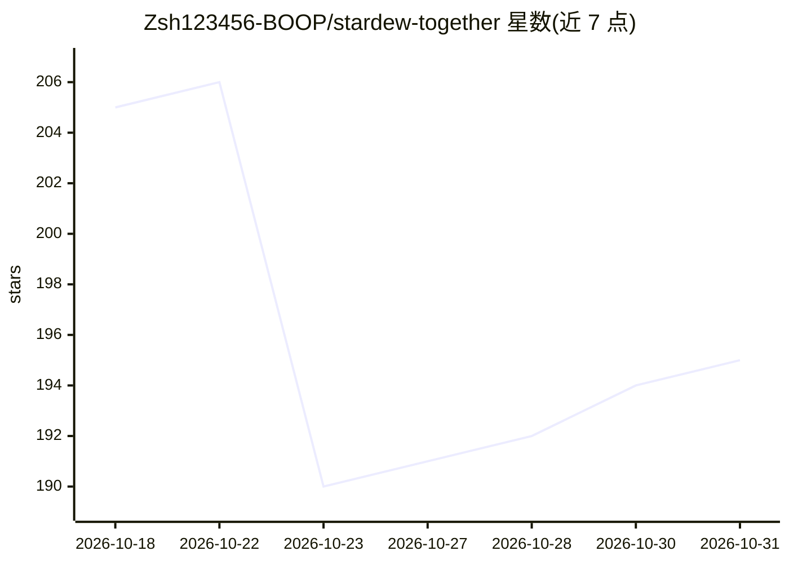

# Zsh123456-BOOP/stardew-together

⭐ 195 · C# · 推送 2026-09-23 · [GitHub](https://github.com/Zsh123456-BOOP/stardew-together) · 组织维护 · 中文 README

**星露谷物玩 AI Agent：自主经营农场并推进任务与全成就**

基于 SMAPI 的 Stardew Valley C# Mod，接入 DeepSeek Flash 模型组成游戏 Agent：读取游戏真实状态（地图、背包、时间、进度），自主选择目标与工具，执行农务、采购、制作、出货等操作，并核验结果。具备记忆归档与检索、上下文压缩、工具按需加载机制，支持暂停接管。已验证环境为 macOS、Stardew Valley 1.6.15、SMAPI 4.5.2、.NET SDK 6，需自备游戏与 DeepSeek API Key。全成就闭环等仍在完善。

## 筛选速览

| 维度 | 判定 | 备注 |
|---|---|---|
| AI 角色 | `ai-native` | 本体是模型或模型工具 |
| 许可风险 | `none` | — |
| 部署形态 | `None` |  |
| 模型依赖 | locked-api |  |
| 硬件要求 | — | 无带数字的原话,不猜 |
| 安装摩擦 | `medium` | 含编译或系统依赖之一 |
| 成熟度 | `idea` | |

## 能力要点

- 通过 SMAPI 读取游戏状态，无需逐帧截图识别
- 记忆按事实/计划/经验分类，带证据 ID 检索（memory.search/memory.evidence）
- 上下文压缩与工具按需加载，工具定义与参数校验共用冻结契约
- 记录全成就运行 153 小时、1.7451 亿 token、API 费用 213.3 元

## 适用场景

- 让 AI 自主经营农场并推进长期目标
- 把一块田的农活交给 Agent，随时接管继续玩
- 查询游戏内物品、配方与成就推进条件

## 场景标签

`GUI 自动化` · 领域:效率与自动化

## 证据(README 行号)

> L5: **面向自主经营、任务与全成就推进的游戏 Agent，也是一位随时可以接手工作的游玩助手。**
> L43:     A[玩家目标] --> B[DeepSeek Flash\n选择目标与取舍]
> L48: 大模型负责有意义的选择，算法负责可计算的细节。Together 直接通过 SMAPI 读取游戏状态，无需逐帧截图识别；正式运行也不依赖常驻 Python 决策服务。

## 星数曲线

2026-10-18 205 → 2026-10-31 195（-10）

---
*卡片 v1 · prompt 1.4 · 生成 2026-10-22 · 置信度 high · 依据 README sha `e883099590fd` · [字段定义](../../DATASET.md)*
