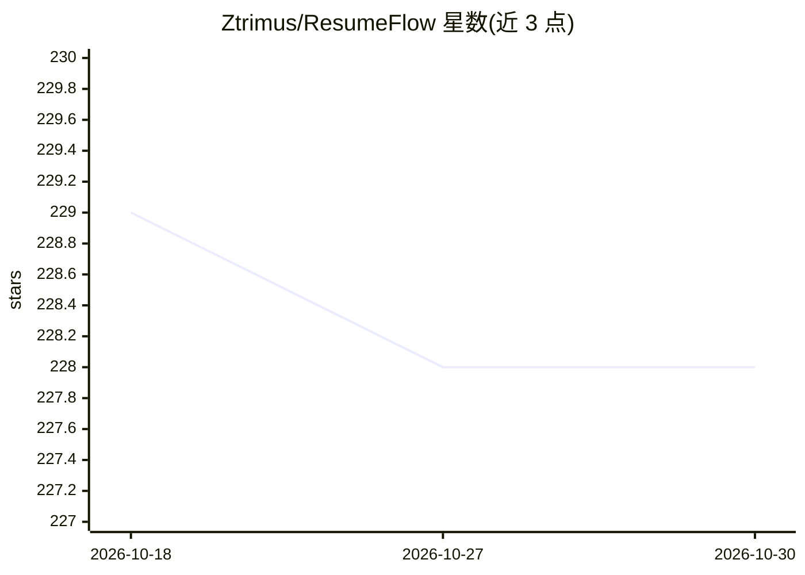

# Ztrimus/ResumeFlow

⭐ 228 · Python · MIT · 推送 2026-06-05 · [GitHub](https://github.com/Ztrimus/ResumeFlow) · [官网](https://dl.acm.org/doi/10.1145/3626772.3657680) · 组织维护

**求职者用 LLM 自动生成岗位定制简历与求职信的流水线工具**

基于 LLM 的求职自动化流水线：读取职位发布 URL 与用户主数据（JSON），调用 LLM（OpenAI/Gemini，亦可配合本地 Ollama 模型如 llama3.1）生成岗位对齐的个性化简历与求职信，通过 LaTeX 转 PDF 输出。提供三种使用方式：Streamlit 网页工具、pip 安装的 Python 包 zlm、源码运行。限 Linux/Mac，需 Python 3.11.6+、LLM API key 及 texlive/basictex 等 LaTeX 依赖。附 ACM 论文与 arXiv 论文。

## 筛选速览

| 维度 | 判定 | 备注 |
|---|---|---|
| AI 角色 | `ai-native` | 本体是模型或模型工具 |
| 许可风险 | `permissive` | MIT |
| 部署形态 | `library` | 以包/库形式分发 |
| 模型依赖 | local-ok | 支持本地模型 |
| 硬件要求 | — | 无带数字的原话,不猜 |
| 安装摩擦 | `low` | 无编译、无系统依赖或容器化 |
| 成熟度 | — | 结构信号不足 |

## 能力要点

- 输入职位 URL 与用户主数据，生成岗位对齐的简历与求职信
- 支持 OpenAI/Gemini API 及本地 Ollama 模型（llama3.1）
- LaTeX 转 PDF 输出简历
- 提供 Web 工具、PyPI 包（zlm）、源码三种使用形式

## 适用场景

- 针对每个投递岗位快速生成定制化简历
- 自动撰写与岗位匹配的求职信
- 批量求职流程中减少重复手工操作

## 场景标签

`AI 写作` · 领域:内容生成

## 证据(README 行号)

> L31: We're aiming to create a automated system that makes applying for jobs a breeze. Job hunting has many stages, and w
> L16:  - Install as a **Python Package** from https://pypi.org/project/zlm/

## 星数曲线

2026-10-18 229 → 2026-10-30 228（-1）

---
*卡片 v1 · prompt 1.4 · 生成 2026-10-22 · 置信度 high · 依据 README sha `eb212c94d0ba` · [字段定义](../../DATASET.md)*
