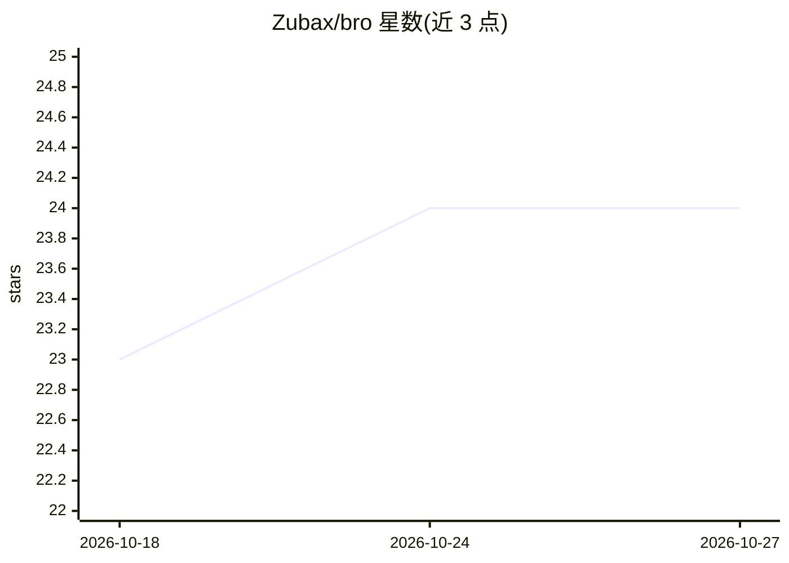

# Zubax/bro

⭐ 24 · Python · 推送 2026-02-04 · [GitHub](https://github.com/Zubax/bro) · [官网](https://zubax.com) · 组织维护

**面向商业运营的 LLM 计算机操作 Agent：自动做账、填表、提交申请**

Zubax 开发的 LLM 计算机使用 Agent（CUA），以无头进程运行于专用虚拟机或备用笔记本，通过远程 Web 界面监控与控制，自主执行记账、文件填报、申请提交等办公事务。推理采用 GPT-5（经 OpenRouter/OpenAI）与 UI-TARS-1.5-7B 做 UI 定位，可换用 OpenAI 官方 CUA 模型或本地运行 UI-TARS（7B 需 32GB 显存）。限制：仅测试于 GNU/Linux X11，单显示器不超 1920x1080，处于活跃开发期且已知含 bug。

## 筛选速览

| 维度 | 判定 | 备注 |
|---|---|---|
| AI 角色 | `ai-native` | 本体是模型或模型工具 |
| 许可风险 | `none` | — |
| 部署形态 | `library` | 以包/库形式分发 |
| 模型依赖 | locked-api |  |
| 硬件要求 | — | 无带数字的原话,不猜 |
| 安装摩擦 | `low` | 无编译、无系统依赖或容器化 |
| 成熟度 | `idea` | |

## 能力要点

- 无头进程 + 远程 Web 界面监控的运行形态
- GPT-5 规划 + UI-TARS-1.5-7B UI 定位的模型组合，可选 OpenAI CUA 模型替代
- 优先使用文件访问、shell、Python 脚本而非直接操作 UI
- 提供 Slack 连接器与 tmux/SSH 长会话实践

## 适用场景

- 在专用虚拟机上让 Agent 代为处理记账与填报等重复办公事务
- 通过 Slack 向 Agent 下达任务指令
- 用备用笔记本部署无人值守的行政自动化流程

## 场景标签

`GUI 自动化` · 领域:效率与自动化

## 证据(README 行号)

> L8: Bro is an LLM computer-using agent (CUA) designed to autonomously perform mundane tasks related to business operatio
> L19: Currently, Bro utilizes the general-purpose GPT-5 for high-level reasoning and planning,
> L21: and the fast and compact UI-TARS-1.5-7B for UI grounding

## 星数曲线

2026-10-18 23 → 2026-10-27 24（+1）

---
*卡片 v1 · prompt 1.4 · 生成 2026-10-27 · 置信度 mid · 依据 README sha `200805c1c28e` · [字段定义](../../DATASET.md)*
